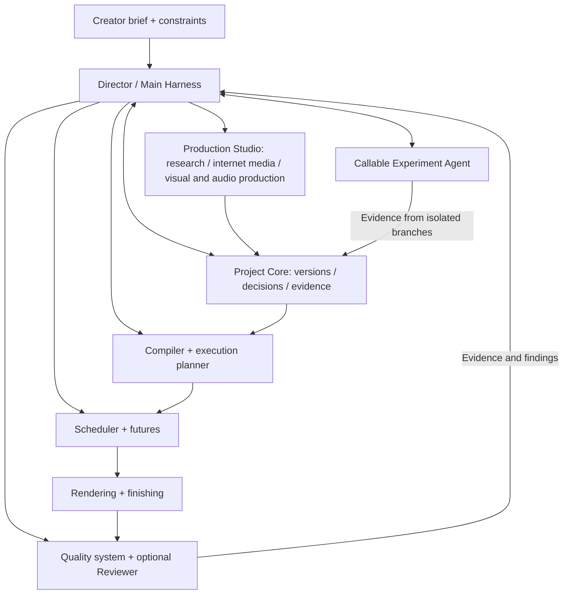

# Cutroom v2 — Full-System HLD · Phase A: Boundaries and Ownership

**Approved design baseline:** 13 November 2026  
**Phase A status:** **ACCEPTED** — logical boundaries and authority model, not a completed system HLD.  
**Next:** Phase B, end-to-end production lifecycle across multiple domains.  
**Related:** [HLD entry](../HLD-ENTRY.md) · [Full product vision](../archive/cutroom-v3.1-full-system-architecture.md) · [Research index](../research-index.md)

> **Scope rule:** This document records what has been agreed at HLD Phase A and explicitly distinguishes open interfaces and implementation choices. It is **not** permission to implement. It is not a replacement for the subsystem research.

## A1. Product and operating constraints — already decided

- **Brief in, finished production out, autonomously.** The Director/Harness decides treatment, story, visual direction, research, asset production, animation, technical approaches, evaluation, internal acceptance, revision and delivery without routine user approval. A brief or configured policy may provide hard constraints and optional intervention points; these are not a required human-in-the-loop workflow.
- **No image-generation models or video-generation models in Cutroom v2.** LLMs may author graphics/animation programs and structured instructions. Rendering uses conventional SVG/HTML/CSS/Canvas/vector/sprite/puppet/procedural techniques and encoding. Eligible existing internet images/footage can be discovered and imported subject to rights, identity and factual provenance.
- **2D-first production**, with 2.5D/3D postponed rather than removed from the long-term vision. The full creative-director/search/critique vision remains authoritative, including humor, narration, pacing, mood, diverse treatments, and final-sequence evaluation.
- **Minimum sufficient complexity.** Favor readable, smooth, stylistically convincing actions rather than mandatory anatomical realism. A pose switch or object motion can be preferable to a rig; IK and detailed constraints remain available when the shot warrants them. Don't create abstraction or agents merely for appearance.
- **Renderer-flexible visual components.** Code-rendered components are the default; structured scene/object/animation graphs are available when they improve controllability, reuse or editing. The harness chooses methods. Preserve earlier detailed DSL/IR/animation research as optional technical depth; do not impose a low-level universal animation graph on every scene.
- **Editable and reversible.** A versioned semantic project is authoritative; code, assets, scene context, compiled plans and render artifacts have traceable revisions. Experiments branch from frozen bases, and rejected trials remain evidence. Local action/component time is mapped to a shared production timebase.
- **Concurrent but coordinated.** Logical layers are editable entities, not mandated render files or processes. Dependencies, futures, version-pinned jobs, caches and early scene/spatial commitments permit work to proceed safely in parallel. Workers agree on composition context (e.g. a volcano's position, plume footprint, and eruption time) before independently staging visuals; the compositor does not repair bad planning.
- **Performance:** Optimize first useful preview, time to accepted result, modification latency, visual quality, and resource/token cost. Splitting work is a measured optimization, not an assumed speedup.

## A2. The accepted eight *logical* subsystems

These are responsibilities with explicit accountability. They are **not eight microservices**, eight always-on models, or a committed deployment layout.

| # | Logical subsystem | Accountable for | Important boundary |
|---|---|---|---|
| 1 | **Director + Main Harness** | Central autonomous controller; creative direction, planning, tool use, delegation, priorities, budgets, recovery, candidate selection, internal acceptance and delivery | Has authority to request actions in **all** systems but uses governed project mutation and typed tools; not the only worker doing production tasks |
| 2 | **Project Core** | Authoritative editable project/DSL, semantic identities, accepted revision head, branches, locks, provenance, history, source maps and experience records | Enforces consistent updates; does **not** make creative judgments |
| 3 | **Production Studio** | Flexible creation capabilities: editorial/factual research, treatments/scripts, storyboards, layout/spatial coordination, programmable illustration, characters, assets, animation/action realization, voice/audio preparation and **internet media research/acquisition** | May use tools or scoped workers, not a fixed army of agents; creates versioned candidates, not unilateral final acceptance |
| 4 | **Compiler + Execution Planner** | Validate the accepted/candidate semantic state, resolve execution requirements, create frozen executable 2D plan, select feasible techniques/render grouping | Must not silently rewrite creative goals or mutate accepted code/assets during frame execution |
| 5 | **Scheduler + Artifact Futures** | Dependency-aware tasks, provisional vs final artifact promises, parallelism, resource limits, cancellation/retries, streaming partial outputs, cache/invalidation | Organizes work, not narrative choices; a promise is a versioned dependency, not necessarily a JS Promise or separate worker |
| 6 | **Rendering + Finishing** | Time-addressable conventional visual rendering, compositing/masks/global effects, audio/video synchronization, captions and encoding | Receives compatible, frozen inputs; not responsible for discovering media or fixing character staging |
| 7 | **Quality System** | Fast deterministic validation, technical/factual/audiovisual checks, actual-output evaluation and an optional **callable Reviewer** | Produces evidence and findings, **not autonomous rewriting or final creative acceptance** |
| 8 | **Experiment Agent** | Callable scoped experiments, variant comparison, technique/renderer investigations, quality/cost evidence and recommendations across Cutroom | May create isolated experiment branches; has no standing authority to replace accepted project state |

### Proposed responsibility topology (not service topology)

The Director can invoke each system directly. Internal data flows and prerequisites may also connect systems without an LLM call for every step.

## A3. Harness strategy — accepted direction

- **One main Director/Harness remains in control.** A modular, plugin-friendly core exposes capabilities through tools/adapters; specialists are invoked for distinct useful work, not invented to mirror the subsystem table.
- Design inspirations explicitly endorsed: **DSH's plugin-based philosophy; Claude Code's scoped delegation; Pi's minimal, extensible core**. These are architectural influences, **not selected framework dependencies**. OpenCode/Codex and other harness designs remain research references.
- A tool call, deterministic function or scoped production worker may be enough for a task. Call another agent only when independent context, specialization, parallel work or investigation brings value greater than token/coordination overhead.
- The Director can dispatch, inspect, interrupt/cancel, retry, review evidence, compare alternatives, and promote a candidate; **all side effects and accepted-state mutations still respect stable revision IDs, constraints and concurrency rules**.
- The Production Studio is a capability grouping, not one mandatory Studio Agent. Likewise, no permanent Research/Character/Script/Audio agents have been approved.

## A4. Reviewer and Experiment Agent — distinct, callable roles

### Reviewer in the Quality System — accepted

**Decision:** Keep a **callable, independent Reviewer** inside the Quality System; no always-running second director and no mandatory model call for each render frame, edit, or trivial task. Use deterministic validation before expensive model review when it can establish correctness.

The Reviewer must see **the main harness's relevant authoritative context**, not work from an isolated paraphrase. It accesses a version-pinned review bundle / retrieval tools, including where applicable:

1. Original brief, goals, hard constraints and expected meaning or shot-level acceptance criteria.
2. Relevant accepted project version, creative decisions, scripts, scene/layout commitments and source diffs.
3. **Ground-truth evidence**: credible source records for factual claims, original media and rights provenance, frozen waveform/word timing, data inputs or specifications where applicable.
4. **Actual produced output**: frames, clips, audio, observed logs, tests and previous findings; the author's intended outcome is **not** proof it happened.
5. Pertinent earlier attempts/accepted stylistic choices so reviews do not repeat known, already adjudicated observations without new reason.

**Important:** Shared authoritative *data* does not mean inheriting all of the Director's unverified assumptions or its entire conversation transcript. Reviewer maintains a fresh, scoped, independent reasoning context while being able to retrieve additional underlying evidence. The Reviewer can challenge a script, the Director's claimed intent/implementation, or a purported source if evidence conflicts. If information is missing, report **UNKNOWN**, not a made-up verdict.

**Reviewer output:** evidence-linked finding, severity/uncertainty, affected revision/scene/time, reason and suggested correction. By default it is **read-only** with no accepted-project mutation privileges. The Director decides whether to fix, investigate, or reject a subjective finding. Invariant violations (e.g. unavailable asset, revoked rights or noncompliant fixed requirement) may independently block final delivery via deterministic checks.

**Review frequency:** risk/uncertainty-driven. Target critical transitions, factual claims, novel interactions and whole-video coherence; avoid automatic reviews for simple, validated tweaks. Reviewer effectiveness, missed defects, false positives, latency and model spend remain to be measured.

### Experiment Agent — accepted

**Decision:** Separate callable specialist for controlled **comparative investigation**, including animation-method choice, visual treatments, performance, renderer/scheduler choices, asset handling and other Cutroom subsystems. May create/test multiple bounded candidates in **isolated branches** and return artifacts, measurements, failures, scope and recommendations.

**Difference:** Reviewer asks *“Is this result correct, clear and fit for the stated goal?”* Experiment Agent asks *“Which alternative works better, and with what evidence/cost?”* Neither replaces the Director. Both can be bypassed for trivial cases and should not become duplicate project owners.

## A5. Autonomous acceptance, policy and versioning

- **No routine human approval gate.** The Director may autonomously promote working candidate `P18` over `P17` and complete/export the project when evidence, explicit brief constraints, hard requirements and production-level acceptance policy are satisfied.
- Creator instructions may declare fixed constraints or protected content; these are **rules already established by the brief/policy**, not a standing requirement to ask the user for every change. If critical requirements genuinely cannot be satisfied, surface a limitation instead of marking success.
- **Project Core** owns atomic accepted-head updates and history. It validates expected base version, authorized actor, locks and revision integrity; it does not decide artistic taste.
- **Quality System** reports technical/factual/creative evidence. A deterministic hard failure can block promotion independently of a model's subjective score. A Reviewer does not approve final delivery.
- Attempts and results are revision-linked. Previously failed methods are retrieved and understood in context; avoid unchanged repeated failures, but never convert one failed trial into a universal prohibition.

## A6. Internet images/video and independent spatial work

**Media Research & Acquisition is a capability within the Production Studio**, not a new top-level subsystem. It owns source discovery, relevance, factual identity, rights checks, media retrieval, clip selection and normalization. The Project Core records source/revision/provenance, and the renderer consumes prepared media references. Internet assets are existing authored media—not model-generated imagery. Voice and audio preparation also live in the Production Studio; Rendering + Finishing composes/mixes/encodes their finalized outputs.

Producers publish **early scene/event/spatial commitments** (e.g. safe zones, target coordinates, dynamic eruption plume envelope, occlusion and timing) to allow parallel staging. Scheduler futures represent availability at a specified revision and readiness level. Final compositing only combines compatible outputs; changing upstream context invalidates affected consumers and cached artifacts. See [coordination research](../research/07-production-coordination-futures-and-spatial-contracts.md).

## A7. Cross-domain coverage for Phase B — not just volcano

Phase B must trace the same accepted ownership model through materially different productions, preserving each domain's real constraints:

| Example domain | HLD lifecycle stress test |
|---|---|
| Comedic historical explainer | Humor/acting, stylized staging, multi-character continuity, no mandatory rig |
| Scientific/documentary (e.g. maglev) | Factual grounding, verified real footage, programmatic overlays/diagrams, timed voice |
| Art-history essay | Authentic artwork, rights/provenance, annotation anchoring under crop/camera changes |
| Software tutorial | Actual UI/screen-content reliability, cursor/time-synchronized callouts, capture revisioning |
| Data-driven business/finance reel | Source numbers, chart data, recomputation when figures change, factual review |
| Abstract/experimental motion graphics | Freely authored procedural effects, synchronization and expressive style without character DSL assumptions |

Phase B should show **which contracts need to exist before work can proceed, which jobs are independent, which require frozen data, how errors/revisions propagate, where reviewers/experiments actually help, and when the Director calls them**. At least one case should include a failed experiment and rollback; another should include a factual/source change that invalidates dependent graphics.

## A8. Decisions explicitly still open — do not silently choose

- Concrete harness/runtime/framework, tool/plugin API, model/provider, context retrieval/pinning mechanics, memory indexing and review invocation thresholds.
- Physical process/service boundaries, agent count, parallel resource budgets and whether any studio role warrants a persistent worker.
- Exact native DSL, executable IR, Scene Context, Artifact Future, Review/Evidence and project-revision schemas and error types.
- Storage and revision technology (Git/CAS/database/event log), permissions implementation, merge/conflict algorithms and caching policies.
- Specific renderers and composition/encoding stack, alpha/color/pixel formats, optimization plans, spatial representations and animation-driver design.
- Actual quality, review, speed, token-cost and concurrency improvements: **not benchmarked or implemented**.

**Phase A exit:** Eight logical ownership areas, central autonomous Director, dynamic Studio, media acquisition, plugin-oriented delegation, callable Reviewer/Experiment Agent with distinct evidence boundaries, version authority, and autonomous acceptance are agreed. **Phase B is next**; no further broad Phase A research is required unless a real cross-domain lifecycle issue exposes a contradiction.
