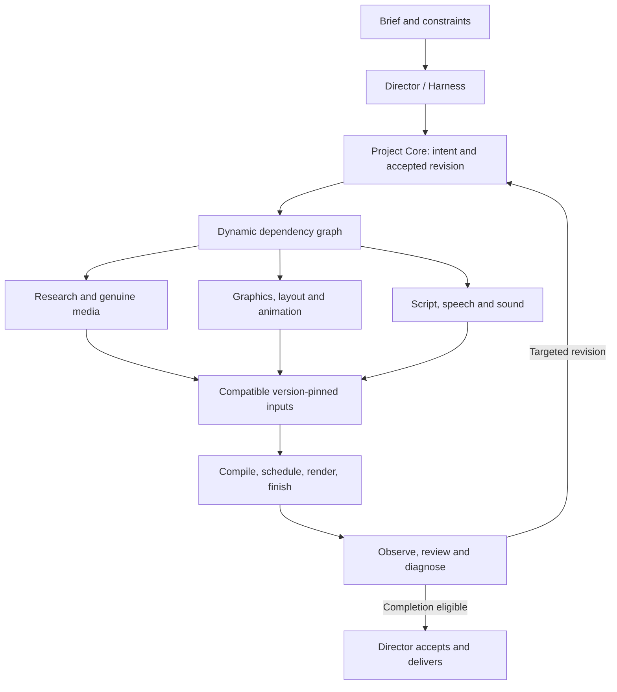

# Cutroom v2 — Full-System HLD · Phase B: Production Lifecycle, Coordination & Autonomous Quality

**Decision baseline:** 13 November 2026  
**Status:** **PHASE B ACCEPTED** — B1 production graph, B2 handoffs/asynchronous execution, B3 evaluation/revision/completion, including the diagnostic-first refinement from Cutroom v1 feedback. This is **HLD-level design direction**, not a completed/approved full-system HLD or an implementation specification.  
**Predecessor:** [Phase A — system boundaries and ownership](01-phase-a-system-boundaries-and-ownership.md)  
**Next:** Phase C — integration contracts and cross-boundary semantics.  
**Further research:** [Harness and experiments](../research/05-agentic-harness-and-experiment-agent.md) · [Coordination/futures](../research/07-production-coordination-futures-and-spatial-contracts.md) · [Versioning](../research/08-versioning-lineage-and-experiment-memory.md) · [Quality and recovery](../research/09-quality-evaluation-review-and-recovery.md) · [Integration/source register](../research/06-integration-evaluation-and-source-register.md)

> **Scope and interpretation.** This document states **accepted architectural behavior** and identifies remaining technical choices. It does not mandate a framework, database, queue, number of agents, microservice layout, universal animation IR, or literal JavaScript `Promise`. Diagrams and message shapes are conceptual. This is Cutroom v2: **no image-generation or video-generation models**. LLMs may create code and production instructions; conventional graphics render pixels. Real existing media may be acquired with sufficient rights and provenance. Evaluating existing frames with a vision-capable model is distinct from generating imagery and is not prohibited.

## B0. Executive decision summary

Cutroom is an **autonomous, brief-in → production-out creative system**. The **Main Director/Harness** is the brain and controller across all eight Phase A logical subsystems. It selects treatments, invokes tools/workers and callable Reviewer/Experiment Agent roles, handles exceptions, compares alternatives, accepts internal working revisions, and delivers without routine human approval. The Production Studio remains a flexible set of capabilities—not a fixed crew of always-on agents. The project stays editable; outputs remain traceable and reversible.

The accepted lifecycle is **dynamic and dependency-driven**, not a mandatory research → script → asset → video assembly line. Agents and tools share a **versioned production blackboard** backed by canonical Project Core state and Scheduler job/artifact state. Tasks have bounded scopes and agreed assumptions; early **commitments** enable parallel work before expensive **artifacts** exist. Only the information a consumer actually requires must be ready. Logical layers do not imply separate render passes or video files. Performance is optimized across creative iterations, code execution, rendering, evaluation and revisions—not nominal frame rate alone.

The quality philosophy is explicitly **diagnostic-first, not rejection-first**. Unlike the overly rigid Cutroom v1 checks, v2 retains and inspects imperfect takes, reports evidence and actionable fixes, and lets the Director direct recovery. A failed intermediate check is normally information, not a command to discard the clip. Only genuine non-negotiable requirements prevent a defective result from being marked as *successfully delivered*. Final-video quality is judged against the brief and treatment; refinement is autonomous but bounded.

---

# B1 — Production graph and decision lifecycle

## B1.1 Dynamic work, not a fixed pipeline

The Director forms a **production intent** from the brief: goals, audience, duration/delivery needs, style, narrative treatment, required factual claims, permissions, hard constraints, and useful quality criteria. It constructs only the work the treatment requires, adapting it as discoveries or problems arise. For example, a programmatic motion-graphics film may need no internet-footage work; a maglev documentary may need extensive source verification. Creative exploration, script, layout, voice, graphics, media acquisition and code-authoring can overlap where their input contracts permit.



A graph is **logical production information**, not a requirement to schedule every shape, eyelid, source line or tiny function. Create graph-level items when separate readiness, parallelism, independent revision, inspection or reuse matter.

## B1.2 Four essential production concepts

| Concept | Meaning | Minimal requirement |
|---|---|---|
| **Project Revision** | Authoritative, editable view of creative intent and selected decisions | Stable identities, lineage, accepted head, candidate branches, constraints and source references |
| **Production Commitment** | Promise about properties consumers may depend on *before* final output exists | Scope, source revision, readiness/uncertainty, validity and update/invalidation semantics |
| **Work Job** | Scoped, repeatable attempt to create/transform/inspect something | Pinned inputs, owner, permitted effects, resources, status, failure and retry ownership |
| **Artifact** | The produced immutable or revision-addressable result | Type, identity, input/producer versions, available intervals and evidence/provenance |

Creative decisions are part of the project revision; commitments **publish relevant decisions** to other producers. A job fulfills a requested outcome with an artifact and may publish partial results. These are conceptual records, **not four new stores or services**. An Artifact Future is the schedulable dependency between an expected result and the consumer, not a fifth project master.

### Decision/commitment readiness

- **Exploring:** Ideas or alternatives are being considered; no guaranteed downstream compatibility.
- **Provisional / published:** Enough declared assumptions exist to start *compatible and reasonably reversible* work, with uncertainty and revision noted.
- **Frozen for a bounded execution:** Specific required inputs are pinned and no longer silently modified by the running job. The Director can still create a **new revision** later.

A commitment and the artifact fulfilling it have **separate readiness**. A scene layout can become usable for character planning before a background render is complete. An unlicensed source prospect or provisional speech timing is not equivalent to a final approved media asset or voice waveform.

## B1.3 Semantic dependencies and local time

Dependencies must express meaning, not only file imports: `claim:maglev-type`, `event:joke_end`, `object:painting-figure`, `source:revenue-series`, `layout:shot-04`, `waveform:narration-take`. A source correction or moved anchor can invalidate narration, annotation, animation or charts even if no common file was directly edited. Underdeclared dependencies require conservative revalidation.

Reusable components, actions and layers evaluate on **local time**, explicitly mapped to scene and production time. Events can be shared across components. A time-addressable component should yield reproducible frames for frozen inputs; stateful effects declare necessary preparation, baking or checkpoints rather than pretending to support arbitrary seeks.

## B1.4 Revisions, branches and acceptance

The project has **one accepted working head** and potentially many candidate branches. Workers do not directly overwrite accepted content. They create versioned results/patches against pinned bases. The Director chooses acceptable changes; Project Core validates base revisions, protected constraints and conflicts and atomically advances the head. Undo/rollback retains previous history. Candidate merge checks meaning: two unrelated file edits may conflict through camera placement, shared lighting, timing or facts.

A generated MP4 is **not** the authoritative editable project; renderer and encode artifacts are derived from accepted code, assets, timeline and contracts. Earlier failures and successful techniques stay indexed with applicable conditions to avoid retrying an unchanged known failure. Historical outcomes do not prohibit new experiments under changed assumptions.

---

# B2 — Subsystem handoffs, collaboration and asynchronous execution

## B2.1 Control plane versus production/data plane

The Director/Harness **can call and control every subsystem**: delegate, inspect, steer, cancel, retry, compare, revise and accept. It doesn't need to relay every file through its LLM context or approve each normal worker transition.

- **Control plane:** Director goals/decisions, capability invocation, optional subagent delegation, budgets and escalation.
- **Production/data plane:** Project Core's authoritative revisions and commitments; Scheduler-owned jobs/futures/events; artifact storage; media, rendered surfaces and review evidence.
- **Shared production blackboard:** A useful **view/access pattern** over these stores and indexes, not an extra source of truth or a required service. Workers retrieve exactly relevant facts and publish scoped outcomes.

Ordinary state changes are handled by tool logic and the Scheduler; notify the Director for consequential completion, blockers, conflicts, quality concerns, or decisions. Events are **hints to inspect current state**, not authority by themselves. Worker-to-worker negotiation is allowed for genuine coordination, but any agreed modification affecting consumers must be recorded as a versioned commitment.

### Why this harness pattern

Phase B2 research compared **DSH** (pluggable services, event-oriented extensibility and subagent providers), **Pi** (small extensible core, tool lifecycle hooks and parallel tool execution), **Claude Code** (scoped subagents, task dependencies and controlled communication), and **Codex** (central supervision, bounded delegation and avoidance of overlapping edits and reflexive waits). They inform Cutroom's design; **none is selected as the implementation**. Tool concurrency, output ordering, agent conversations and artifact dependency order are distinct concerns. Detailed links and limitations are in [harness research](../research/05-agentic-harness-and-experiment-agent.md).

## B2.2 Required handoffs by responsibility

| Producer → consumer | Handoff, rather than whole-agent conversation | What must be protected |
|---|---|---|
| **Director → Studio/tool** | Goal, task scope, expected output, allowed changes, brief constraints, budget, input refs | No unauthorized change to script, appearance, protected decisions or other jobs |
| **Studio ↔ Project Core** | Script/treatment, source evidence, scene spatial/event commitments, code-created or genuine sourced assets, provenance | Stable IDs, rights, fact/source fidelity, revision lineage |
| **Project Core → Compiler/Planner** | Coherent semantic snapshot with resolved execution choices and pinned dependencies | No unresolved creative promises masquerading as executable inputs |
| **Compiler/Planner → Scheduler** | Frozen execution manifest: component/renderer choices, shared time/space, grouping, dependencies, requested outputs | No implicit mutation of active render inputs |
| **Scheduler → worker/Renderer** | Version-pinned job, resource budget, frame range, input/code/assets, expected format and result ref | Safe retry, cancellation, idempotency and deterministic reproducibility |
| **Renderer → compositor/finishing** | Compatible surfaces/segments with time map, z/mask/alpha/color rules, event and revision bindings | No incompatible layer combination; cross-pass effects honored |
| **Render/Studio → Quality** | Actual output plus original brief, expected behavior, ground-truth refs, logs and prior outcomes | Review actual evidence, not only a producer's intentions |
| **Reviewer/Experiment → Director** | Scoped findings or comparative trials with evidence refs, cost, uncertainty, revisions | Reviewer read-only; experiments isolated; no unilateral promotion |

The Production Studio explicitly includes **internet media research and acquisition**. Research discovers relevant existing images/footage/audio, verifies subject identity/relevance and licensing, retrieves originals or acceptable proxies, and prepares crops, time spans and standardized media. Project Core keeps provenance and rights records. The engine does **not** create images or video via generation models.

## B2.3 Promises/futures are production-wide

Artifact Futures are useful for research bundles, scripts, selected media, visual looks, character references, layout, narration waveforms/timestamps, code-authored animation components, render frames/ranges, composites, reviews and experiment evidence. They express **who will supply what under which contract and revision**, not a requirement for literal JS promises or microservices. If a consumer needs only stable scene bounds, it may start before pixels exist. Expensive work should generally wait when its provisional assumptions are likely to change and invalidate it.

A work dependency must be scoped to an **exact revision and readiness level**: `contract published`, `partial interval ready`, `complete artifact ready`, `validated`, or `accepted for this job`. A cached preview is not equivalent to final delivery. Job life cycles may include declared, waiting, ready, running, partial, completed, failed, cancelled, superseded. The exact public state enum is deferred to Phase C/LLD.

## B2.4 Avoiding idle waiting and duplicate work

1. **Declare read/write scopes**. A worker may update its own action/code while reading shared dialogue and layout; expanding scope requires a proposed patch or Director authorization.
2. **Deduplicate equivalent work** by pinned inputs, requested output and execution parameters where safe. A second consumer may join an existing future or reuse a valid artifact. Don't infer equivalence solely from a human-readable job name.
3. **Run independently ready work** without LLM-mediated forwarding; group tiny operations in-process, split meaningful tasks only when faster or more reusable.
4. **Use events, not polling loops** to inform the Director of important completions and blockers. Project Core remains source of truth; Scheduler owns job statuses.
5. **Pin versions and validate freshness on result publication**. A late P18 result may still be reused in P19 *if* its dependency closure is valid, but must not silently replace a P19 dependency that changed.
6. **Assign one retry authority** per external side effect and use stable job IDs, idempotency/deduplication and bounded retries. A browser crash differs from a failed artistic approach.
7. **Publish diagnostic evidence**, not just `failed` or `hand movement bad`; preserve partial work, logs and attempts. See B2.6.
8. **Keep resource budgets and backpressure**. Parallelism should not inflate browser startups, duplicate memory-heavy frames or cause more overhead than it saves.

### Spatial coordination before final pixels

Workers publish the relevant **scene context**: coordinate frame/camera, static or time-varying occupied regions, safe/avoid areas, draw order, masks/occlusion, event anchors and effects crossing passes. A castle, painting crop or erupting volcano needs to expose enough for character/caption workers to stage around it. A simple box/anchor may suffice; no universal collision solver is mandated. Changing a commitment updates downstream dependencies; a compositor must not be asked to invent staging after independent pixels arrive.

### Physical rendering remains adaptive

**Logical editing layers ≠ physical render jobs**. Planner may co-render compatible layers, split expensive components or frame ranges, reuse cached backgrounds/surfaces, and stream partial results when supported. Each output declares time mapping, dimensions, alpha/color, masks/order and revision. Whole or partial frames may be composited as they become compatible; workers and compositor need bounded buffering/backpressure. Cross-layer glow, camera movement, masks and shadows can require grouped execution or wider invalidation. Select strategies using measured latency, quality and memory—not an unconditional parallelism rule.

## B2.5 Scoped specialist roles

**Reviewer (Quality System):** Callable when a judgment benefits from independent scrutiny. Receives a **version-pinned, retrievable bundle** of the original brief, relevant accepted decisions, ground-truth sources/data/rights, selected actual frames/clips/audio/code/logs, and prior findings. It has a fresh critical reasoning context **but shares authoritative underlying information**; it must not simply inherit the Director's unverified interpretation. It reports evidence, uncertainty and defects; does not edit accepted project state.

**Experiment Agent:** Callable to compare genuinely uncertain approaches across story, animation, renderer, cache, review or other systems. Receives a frozen base, scoped allowed changes, constant comparison conditions, budget and metrics; works on isolated branches and returns artifacts, costs, quality evidence and recommendations. It cannot replace the Director or autonomously promote its trials. Normal tools/workers need not become named long-lived agents.

## B2.6 Evidence-rich worker diagnostics and bounded recovery

**DECIDED:** A failure or poor result should lead to **actionable evidence**, not a vague adjective or a rigid clip rejection. Workers that can inspect their own outputs should report: expected behavior; **observed** behavior and precise time/frame/object/source location; artifact and test/log references; competing root-cause **hypotheses with confidence** (not invented certainties); attempted repairs; specific candidate corrections and expected edit/invalidated dependencies; remaining unknowns and resource cost. A lightweight technical error can use fewer fields than a complex visual failure.

The Director receives **two levels**: a short structured notification and a retrievable **Diagnostic Evidence Bundle**. Logs/frames/code diffs remain outside the Director's active token context until needed. The worker may attempt a **bounded local repair within its allowed write scope**, validating the result and recording attempts. A creative treatment change, cross-system dependency change or repeated unsuccessful repair escalates to the Director. Reviewer may independently inspect uncertain evidence; Experiment Agent may compare costly alternatives. Do **not** add a mandatory Debugging Agent.

```yaml
# Illustrative ONLY — exact schema deferred
outcome:
  job: character-handoff@job-21
  base_project: P24
  status: needs_revision
  expected: "Readable prop transfer from Alice to Bob"
  observed:
    - "Visible prop position jump at global time 3.20–3.24 s"
  evidence:
    - "preview:scene-04/frames-96-97@candidate-08"
    - "code:document-motion.ts@v6"
  hypotheses:
    - cause: "Attachment switches before receiver pose reaches contact"
      confidence: provisional
  suggestions:
    - "Align attachment event and receiving pose; preserve background"
    - "Try short overlapping hold or a simpler cutaway"
  impacted: ["alice-motion", "bob-motion", "document-prop"]
  completed_local_repairs: 1
  known_unknowns: ["Whether the staging itself needs reframing"]
```

A report must separate **observed facts**, **suspected causes** and **recommendations**. The same pattern supports a wrong factual source, a misaligned caption, a broken software UI step or an invalid chart value. An optional human-readable summary should link to exact versioned evidence rather than substitute for it.

---

# B3 — Evaluation, revision and autonomous completion

## B3.1 Diagnostic-first quality: Cutroom v1 lessons

**DECIDED REFINEMENT:** Cutroom v1's overly strict take/clip gates rejected output without a supervising harness able to inspect, reason and repair. **Cutroom v2 must not recreate that rejection-first model.** Its programmable animations, shared blackboard, versions and visible render code allow more reproducible inspection and targeted correction, but do **not guarantee** good pacing, flawless visuals or factual accuracy.

The Quality System is an **instrument for the Director**, not an alternate authority. Checks should produce observations, evidence, defect location, uncertainty and suggested repairs. **Imperfect intermediates and rejected trials remain inspectable and may be used for planning/review with limitations marked.** Only actual hard requirements may prevent an artifact from being labeled as a *successfully completed final deliverable*. A hard failure still yields a report and recovery path where feasible; it does not erase a clip or automatically force a full restart.

### Distinct check meanings

| Type | Purpose | Effect |
|---|---|---|
| **Observational** | Detect possible overlap, unusual motion, timing, style or pacing defects | Report and prioritize; no automatic rejection |
| **Corrective / executable validation** | Establish broken refs, syntax, missing media, invalid timing/render paths and repairable technical issues | Report actionable location; permit bounded local correction; may prevent use in operations requiring valid input |
| **Hard delivery constraint** | Enforce non-negotiable brief, rights/provenance/essential facts, integrity, required file/output guarantees | Prevent false *successful delivery* while unresolved; preserve evidence and allow recovery |

This is **not** an invitation to ignore broken dependencies or rights. Intermediate progress may continue safely with flagged defects, but final export cannot claim compliance without requisite evidence. Brief-derived policies and external system constraints are not recurring requests for user permission: normal acceptance is **fully autonomous**.

## B3.2 Quality Intent and three scopes

The Director derives **production-specific Quality Intent** from the original brief and selected treatment: purpose, audience, facts and source standards, stylistic freedoms, key narrative/acting aims, hard constraints and what the final film must communicate. It is a small versioned part of project intent, not a mandatory elaborate universal scoring formula.

1. **Component:** Does the code/audio/media/animation produce the required signal? Fast tests, sampled frames and diagnostics.
2. **Scene / shot:** Do components communicate the action correctly together? Timing, staging, spatial coherence, visual style, voice synchrony and appropriate factual content.
3. **Complete video:** Does the assembled production work as **one film**? Opening, flow, pacing, continuity, transitions, emotional/comedic arc, audio, overall legibility and final requirements.

A still-frame sample cannot prove temporal continuity; a technically valid shot cannot prove the film's story works. The system must record what the reviewer **actually inspected** (intervals, audio, full-film coverage) and report `unknown` when evidence is missing.

## B3.3 Review triggers and authority

Use deterministic checks first when they can answer the question. Call the **independent Reviewer** for meaningful uncertainty or risk: novel interactions, disputed factual representation, difficult continuity, major edits, or full-film creative/technical assessment. A changed label may require only a cheap layout check and preview; not a new costly reviewer call.

The Reviewer can challenge a script or the Director's assertion using external source evidence and **actual output**; it cannot assert it inspected unseen frames. It returns localized findings, severity, evidence refs, coverage, confidence and suggested repairs. The Director may accept, reject or investigate subjective criticism. An actual hard invariant can block final compliance independently of either agent's creative taste.

**Reviewer ≠ Experiment Agent:** Reviewer asks whether the current output meets its intent; Experiment Agent tests which alternative works better, with controlled candidate branches and cost. The Director remains the brain of both workflows.

## B3.4 Evidence-based revision and regression checks

On a material finding, the Director determines the **smallest semantically sufficient change**—which may be a staging adjustment rather than a tiny code patch. It creates a scoped candidate branch and uses the Dependency Index to identify work to rebuild or revalidate, preserving compatible assets/surfaces. Re-render affected ranges when safe and evaluate the revised **actual** output in isolation and relevant full context. Compare against the previous accepted revision; keep whichever valid candidate best satisfies the production purpose. Record regressions, costs, accepted decisions and failed hypotheses.

Low-level worker fixes can be bounded and automatic within scope. Larger changes to story, layout, source truth, performer identity, global camera or audio timing should escalate to the Director because they can invalidate multiple dependents. Review cycles are **new revisions**, not circular dependencies in a single frozen render graph.

## B3.5 Bounded autonomous completion

No user approval is required at each revision or final delivery. The Director can promote a suitable candidate and export automatically under the brief's constraints and production policy. To avoid endless perfection loops, distinguish:

- **Blocked:** An essential required condition is failed or unknown in a way that prevents reliable successful delivery; repair, replace or report inability.
- **Needs material revision:** A real output defect undermines the purpose. Prioritize it and perform bounded repair/investigation.
- **Eligible:** Non-negotiable requirements are satisfied and no known material defect remains. Optional improvements are possible.
- **Deliver:** The eligible candidate is accepted, the expected marginal benefit of further work does not justify latency/cost/regression risk (or the optional improvement budget is used), and exported-file validation passes.

The quality condition and stopping/economic condition must **both** be considered. Exhausting the budget does not convert an invalid result into success. Subjective reviewer disagreement does not automatically imply endless escalation or another full render. Use meaningful comparisons, prior experience and evidence rather than a universal numerical quality score.

## B3.6 Final-output checkpoint

After freezing the final dependency set, inspect the **actual exported deliverable**, not only the project preview: complete scenes/frames, codec/container and dimensions, duration, audio/caption synchronization, required source permissions/factual assertions, unresolved severe visual defects, and whole-film coherence. Publish the final artifact with its project revision, code/asset/render-environment versions, source/provenance records, evaluation coverage and known limitations. A later modification is a **new deliverable revision**; do not silently replace historical evidence.

---

# B4 — Cross-domain stress tests

The same lifecycle must survive distinct content types. These are **design walkthroughs, not implemented tests or benchmarks**.

| Domain | What can start early/in parallel | Dependency or defect that must propagate | Recovery and review focus |
|---|---|---|---|
| **Comedic history** | Historical grounding, joke/treatment search, character look, map/scene layout, voice direction | Dialogue events change, or a character handoff fails to read | Adjust pause/pose/framing or experiment with simpler motion; review humor and actual acting; reuse background |
| **Scientific maglev documentary** | Fact research, authentic footage search, programmable technical diagrams, outline | Chosen source actually depicts the wrong train/technical mechanism | Correct source and affected claims/diagrams/labels; factual and visual grounding before delivery |
| **Art-history essay** | Artwork/source verification, narration, annotated region planning, code narrator | Crop changes mapping of a named feature in an authentic painting | Recompute annotation/pointing anchors; preserve compatible audio and source provenance |
| **Software tutorial** | Script, UI capture, cursor/callout styling | Screen-state/interface revision makes an action or highlight inaccurate | Recapture affected steps; fix timestamped cursor/caption dependencies; validate actual product behavior |
| **Data/finance reel** | Chart styling, narrative exploration, dataset/source verification | Verified figure changes, making charts and narration stale | Recompute bound chart geometry and claims; revalidate factual dependency set |
| **Abstract motion graphics** | Procedural shapes, kinetic type, audio/rhythm planning, renderer technique trials | Visual/audio beat mismatch or expensive effect performs poorly | Adjust local-time mapping; compare render methods; review rhythm and overall visual coherence |

Coverage needed in future integration tests: **one failed experiment with rollback**, **one corrected fact invalidating multiple distinct artifact types**, **one late stale worker completion**, **one spatial commitment change**, **one cross-layer effect**, **one repaired-but-still-imperfect preview**, and **one final exported-file failure**. The harness should preserve evidence and select a targeted remedy in each case.

# B5 — Boundaries, performance and unresolved work

### Accepted boundaries

- Eight **logical** Phase A responsibilities stay intact. No agent or microservice per activity; no mandatory Debugging Agent.
- **One authoritative project revision**, many scoped candidates and durable, evidence-linked attempts; workers never silently mutate accepted content.
- One main **Director/Harness** with modular/plugin-based tool access and useful scoped delegation (DSH/Pi/Claude Code/Codex lessons); the Reviewer and Experiment Agent are separate **callable** roles.
- **Shared blackboard is a view, not another project master**. Events notify; revision state decides. Work runs in parallel only when relevant contracts are compatible.
- **Diagnostic-first QA**, versioned previews and corrective evidence, not Cutroom v1's strict automatic take rejection.
- **No video or image generation models**, no mandatory universal character rig, no mandated one-video-per-layer; expressive creative choices and original full-system vision preserved.

### Evaluation/performance goals (not measured achievements)

Time to first usable preview; time to accepted video; latency of meaningful revisions; job blocked time and speculative waste; cache correctness/hit rate; resource CPU/GPU/RAM; model tokens/tool spend; reviewer useful defect detection versus false positives; fraction of repeated known failures; final-film quality and compliance. Compare grouped-versus-independent rendering, failure-driven targeted rerenders and reviewer trigger policies using equivalent creative requirements. No actual Cutroom v2 benchmarks have been performed.

### Still OPEN for Phase C / technical research and LLD

- Exact Project Revision, Commitment, Artifact/Future, Task Request, Diagnostic Evidence, Review, Render Surface and Experiment schemas; source maps, timescale and coordinate contracts.
- Accepted-head concurrency/merge protocol and event transport; API permissions, lease/ownership and provenance enforcement; artifact cache keys, retention and snapshots.
- Renderer adapter selection (browser/HTML, canvas/GPU/native 2D, hybrid), alpha/color/mask/surface transport, frame chunk/stream protocols and whether co-render or split is faster on the target device.
- Scheduling algorithm, speculative work policy, max concurrency/worker retry budgets, crash recovery/idempotency and desktop/distributed deployment topology.
- Agent/runtime/plugin implementation, context retrieval, ground-truth verification, Reviewer trigger thresholds, quality rubrics/calibration, failure/evidence ranking and acceptable end-to-end budgets.
- Media acquisition providers/rights workflows and voice/audio stack, with no image/video-generation models.

**Next formal phase:** **Phase C — subsystem integration contracts** (precise HLD-level boundaries, invariants and failure semantics), followed by full HLD review, focused technology choice, subsystem LLDs, and explicit implementation approval. No product code, renderer prototype or architecture benchmark has been authorized by Phase B agreement.
