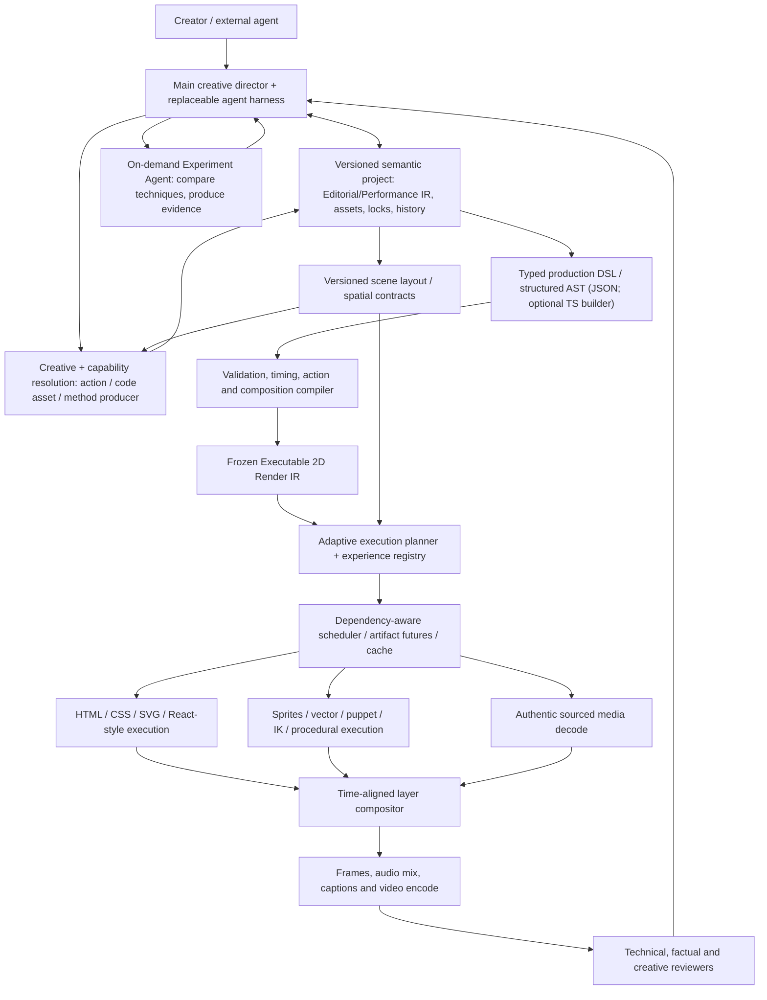

# Cutroom v2 — Overall Research & Subsystem Index

**Updated:** 14 November 2026  
**Status:** Active overview / decision register; broad engine research complete for HLD entry. **HLD Phases A–C accepted; focused technical research and subsystem LLDs next. No implementation authorized.**  
**Routine vision:** [VISION.md](VISION.md). **Original detail on demand:** [unchanged v3.1 archive](archive/cutroom-v3.1-full-system-architecture.md). **Current authority:** [HLD entry](HLD-ENTRY.md) and accepted A–C HLD.  
**Rule:** Keep **summaries, relationships, decisions and open questions here**. Put detailed analysis, example DSL/IR schemas, technical comparisons, references and experiment designs in the linked subsystem research files. Do not duplicate research sections into this index.

## Product north star — still intact

Cutroom is an **AI-directed, editable audiovisual production system**: it researches, invents, writes, directs, animates, incorporates genuine media, compares treatments, reviews, revises and learns. The current scope is **2D video**, created by LLM-authored code and conventional rendering (sprites, layered puppets, vectors, HTML/SVG/Canvas, authentic sourced photographs/footage, speech and sound). **No image-generation or video-generation models in Cutroom v2.** Defer 2.5D and 3D compilers/renderers rather than removing them from the long-term vision. Creative narrative, humor, sarcasm, emotional trajectory and quality-diversity exploration remain integral, even though our current technical focus is language/compiler/render execution.

## Research architectural picture (logical; accepted A–C HLD governs)

**Interpretation:** The diagrams show responsibilities, not a commitment to independent services. Logical layers are not necessarily separate render jobs; producers coordinate using versioned spatial/event contracts. Project revisions and experiments are traceable. The harness can experiment with the renderer/animation-method assignment at different scopes. The Execution Planner filters feasible candidates and uses the registry as evidence; the Experiment Agent tests alternatives on demand. A missing action can initiate a capability-production workflow before frozen compilation rather than causing automatic immediate rejection.

## Decision register — accepted HLD Phases A + B + C (14 November 2026)

| Status | Decision / requirement | Boundary |
|---|---|---|
| **DECIDED** | Initial execution scope | **2D, code-created and conventionally rendered visuals; NO image-generation or video-generation models in v2**; sourced genuine media permitted |
| **DECIDED** | Product agency and full vision | User submits brief; harness owns creative treatment, script, design, assets, animation, assembly, evaluation and revisions; preserve the entire v3.1 creative/search vision |
| **DECIDED** | Acting fidelity | Optimize readable, smooth, style-consistent action; simple poses/staging valid, physical precision/IK when justified |
| **DECIDED** | Authoring DSL | Renderer-neutral structured typed semantic project (JSON/AST; optional TS builder); no custom textual language parser initially |
| **DECIDED** | Default visual unit | **Code-rendered components by default**, optional richer structured scene/animation graph when valuable; harness chooses per shot/object/action |
| **DECIDED** | IR authority | Semantic project is editable source of truth; frozen compiled executable 2D plan and renderer-specific artifacts are derived; do not require universal low-level curves for every component |
| **DECIDED** | Layers and parallel work | Independent logical compositing/editing; may render grouped or split; use bounded asynchronous artifact futures/jobs, local timelines, partial previews and reusable caches |
| **DECIDED** | Spatial coordination | Independent producers publish **versioned layout/footprint, occlusion, avoid-zone and event contracts** so scenes are staged consistently before final surfaces exist |
| **DECIDED** | Version management | Semantic object/scene/layer/code/asset revisions, reversible branches/patches, experiment lineage, failed-attempt history, safe reuse and cache invalidation |
| **DECIDED** | Adaptivity and experiments | Adapt/create feasible missing **programmatic** animation capabilities; on-demand Experiment Agent can compare approaches across the whole system |
| **DECIDED** | Engineering priorities | Time to usable preview/accepted video, revision latency, cost, quality; avoid unnecessary services/rules; preserve useful earlier research |
| **DECIDED** | Phase transition | **HLD A–C accepted; proceed to focused technical comparisons and LLDs**, implementation only after explicit approval |
| **PHASE A ACCEPTED** | Full-system logical ownership | Eight responsibilities: central autonomous Director/Harness, Project Core, flexible Production Studio, compiler/planner, scheduler/futures, rendering/finishing, Quality System, callable Experiment Agent |
| **PHASE A ACCEPTED** | Harness and specialist policy | Plugin-oriented minimal core; scoped useful delegation. Independent Reviewer in Quality System reads authoritative project/ground truth/render evidence and reports; separate Experiment Agent compares candidates |
| **PHASE A ACCEPTED** | Acquisition and autonomy | Internet media research/acquisition is in Production Studio; Director promotes/ships compliant revisions autonomously, no routine user approval |
| **PHASE B1 ACCEPTED** | Production lifecycle | Dynamic graph; revision/commitment/job/artifact; exploring, provisional and execution-frozen commitments; local time, semantic dependencies, selective invalidation and candidate branches |
| **PHASE B2 ACCEPTED** | Coordination and failures | Shared versioned blackboard over existing Project Core/Scheduler state; scoped delegated workers; early contract futures, event-driven status, deduplication; revision-safe parallel render grouping; evidence-rich diagnostics and bounded local repair |
| **PHASE B3 ACCEPTED** | Quality and completion | Production-specific criteria; component/shot/whole-video scopes; Reviewer risk-based and evidence-grounded; diagnostic-first rather than strict reject-first; hard delivery constraints separated from creative judgment; bounded Director-led revision and exported-file checkpoint |
| **PHASE C ACCEPTED** | Integration contracts | Nine logical contracts with ownership, readiness, revision integrity, failure/evidence semantics and A–C design consistency review; exact schemas and implementation remain open |
| **LLD PROCESS ACCEPTED** (14 Nov) | Design-first with spikes | Design every stage R1–R10, verify claims with throwaway spikes, freeze review, then implement. [Process and roadmap](lld/00-design-process-and-roadmap.md) |
| **R0 ACCEPTED** (14 Nov) | Framing | Local machine then Linux VM; WSL2 + `chrome-headless-shell` + BeginFrame as the one render path; TypeScript core, Python worker when first needed, no Rust yet; MiniMax (M3 for direction/review, M3.1-Flash for code); AI music/SFX/dialogue allowed, providers deferred; budget about $5 per film, $15 cap. [R0](lld/01-r0-framing-decisions.md) |
| **R1 ACCEPTED** (14 Nov) | Shared foundations | Integer flicks for time; half-open frames; events round up to the next frame; entity IDs plus handles; SHA-256 content hashes; one work key; y-down design units; readiness as separate facts; `unknown_outcome` job state; evidence convention with coverage. [R1](lld/02-r1-foundations.md) |
| **EVIDENCE** (14 Nov) | Spikes S1, S1c, S2 | Capture speed and repeatability on Windows and WSL2; MiniMax component authoring and contact-sheet review. [Evidence log](research/10-spike-evidence-log.md) |
| **R2–R10 DECIDED** (14 Nov) | Low-level design | Decided by the lead session under the user's delegation, then reconciled, spike-verified and freeze-reviewed: components and rendering, project model, compiler, scheduler, harness, studio tools, quality, acceptance and build plan. See [`lld/`](lld/) files 03–11 |
| **EVIDENCE** (14 Nov) | Spikes S3–S7, batches 2 and 3, three mechanical consistency passes, one independent review | [Evidence log](research/10-spike-evidence-log.md) and `research/evidence/` |
| **DECIDED** (15 Nov) | The user's decisions and how the build runs | Audio engines, voice policy, listening, AI labelling, ShareAlike, provider contact identity, tutorial capture basis and production VM are decided by the user and recorded in [integration decisions](lld/11-integration-decisions.md) section 17 (listed in [R10 §4.3](lld/10-r10-integration-acceptance-and-build-plan.md)); the open points found while planning the build are decided in section 18. The build is planned under `impl/` and has not started |

**Supersession note:** Detailed pre-13-November source research below contains older, broader candidates (including image/video generative models and universal low-level IR designs). **They are historical alternatives, NOT active Cutroom v2 requirements**. Current approved constraints and the [HLD entry](HLD-ENTRY.md) control interpretation. No earlier experiments or benchmarks are represented as implemented.

## Dedicated subsystem research files

1. **[DSL, compiler and Executable 2D Render IR](research/01-dsl-compiler-executable-render-ir.md):** typed language forms, code generation, time-addressable rendering, semantics, validation and capability gaps.
2. **[Layers, compositing and incremental revision](research/02-layers-compositing-and-incremental-revision.md):** semantic objects vs visual layers vs surfaces, hybrid execution, masks/effects, caching.
3. **[Animation, behavior and capability growth](research/03-animation-behavior-and-capability-growth.md):** puppet/rig/IK/sprite representations, interactions, action registry, missing-action adaptation.
4. **[Real-media asset retrieval and preparation](research/04-asset-retrieval-rights-and-preparation.md):** source selection, download, rights, authenticity, media preparation.
5. **[Harness and Experiment Agent](research/05-agentic-harness-and-experiment-agent.md):** agent responsibilities, dynamic renderer-method trials, bounded experiments, resilience, reviews and promotion.
6. **[Integration, evaluation, open questions and source register](research/06-integration-evaluation-and-source-register.md):** end-to-end volcano journey, cross-cutting requirements, historical source links and decision gates.
7. **[Production coordination, spatial contracts, futures and scheduling](research/07-production-coordination-futures-and-spatial-contracts.md):** early spatial/layout commitments, async work across the whole production, parallel job graph and version-pinned delivery.
8. **[Versioning, lineage and experiment memory](research/08-versioning-lineage-and-experiment-memory.md):** semantic revisions, rollback, branches, caching, prior success/failure evidence and conflict-aware merges.

10. **[Spike evidence log](research/10-spike-evidence-log.md):** measurements from throwaway spikes (capture speed, repeatability, MiniMax authoring).
11. **[Provider, cost, language and audio research](research/11-provider-cost-and-audio-research.md):** MiniMax facts, cost model, language comparison, code-generated and open-source music, sound effects and voices.

**Low-level designs** live in [`lld/`](lld/): [process and roadmap](lld/00-design-process-and-roadmap.md), [R0](lld/01-r0-framing-decisions.md), [R1](lld/02-r1-foundations.md), [R2](lld/03-r2-components-and-rendering.md), [R3](lld/04-r3-project-model-and-storage.md), [R4](lld/05-r4-compiler-and-render-plan.md), [R5](lld/06-r5-scheduler-and-recovery.md), [R6](lld/07-r6-harness.md), [R7](lld/08-r7-studio-tools.md), [R9](lld/09-r9-quality.md), [R10 acceptance and build plan](lld/10-r10-integration-acceptance-and-build-plan.md) and the [integration decisions](lld/11-integration-decisions.md). The v3.1 archive is no longer consulted (see [AGENT.md](../AGENT.md)).

**[Focused Quality, Reviewer and recovery research](research/09-quality-evaluation-review-and-recovery.md):** v1 → v2 diagnostic-first change, evidence coverage, scoped Reviewer, repair/acceptance policy and future evaluation benchmarks.

**[HLD entry and approved decision baseline](HLD-ENTRY.md)** — current scope and phase. **[Accepted HLD Phase A — system boundaries and ownership](hld/01-phase-a-system-boundaries-and-ownership.md)** — ownership and authority. **[Accepted HLD Phase B — production lifecycle and autonomous quality](hld/02-phase-b-production-lifecycle-and-autonomous-quality.md)** — B1/B2/B3 decisions and cross-domain traces. **[Accepted HLD Phase C — integration contracts](hld/03-phase-c-integration-contracts.md)** — cross-boundary guarantees and final A–C consistency review.

Detailed research and evidence should be edited **in the relevant subsystem file**. Update only the summary, links and decision status in this overview. Routine creative-search and future-system coverage is summarized in [VISION.md](VISION.md); consult the v3.1 archive only for original detail, especially its editorial, creative-search and evaluation sections.

## Phase transition — accepted HLD to technical research and LLD

**Agreed:** Broad 2D DSL/engine research and **HLD Phases A + B + C are complete at architecture level**. Do not restart open-ended surveys or infer technology choices from historical candidates. The [HLD entry](HLD-ENTRY.md) and [Phase C](hld/03-phase-c-integration-contracts.md) govern the accepted integration baseline. Earlier phase/research stage notices describe their historical point in the process; exact technical choices remain open.

Next, research/decide concrete technology per subsystem, prepare detailed LLDs and integration acceptance tests, then seek explicit implementation permission. Unproven performance benefits require benchmarks at the appropriate stage; no product implementation is claimed here.

## Evidence discipline

Existing animation frameworks and rendering standards are **precedents for mechanisms**, not proof that Cutroom's end-to-end quality, cost or reliability goals are met. The 2017 ICFP *Super 8 Languages for Making Movies* paper is a **separate research precedent, not an adopted design**; it remains in v3.1 Appendix E and the DSL subsystem's background. Source references in the new 13 November coordination/versioning papers are conceptual precedents, not an implementation claim. Existing older citations keep their historic verification dates. No actual Cutroom tests or prototypes were run.
