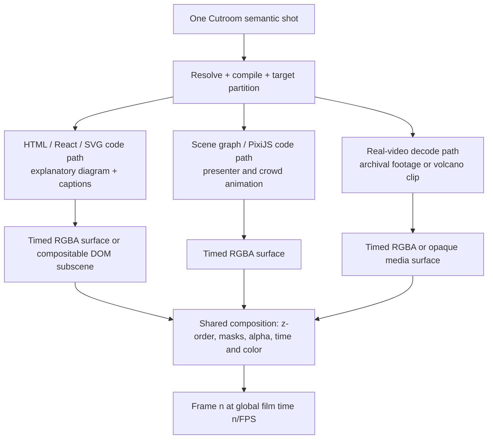
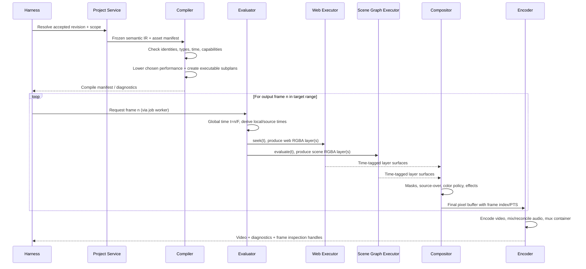

# DSL, Compiler, Executable 2D Render IR & Video-Code Research

**Cutroom v2 | Subsystem research | Updated 13 November 2026**  
**Status:** Research and proposed contracts, not approved HLD or LLD; nothing implemented.  
**Parent:** [Main research index](../research-index.md) · [Full vision](../archive/cutroom-v3.1-full-system-architecture.md)  
**Scope:** Language representation, time-addressable execution, capability gaps, code generation, backend independence and source mapping.

---

## 13 November HLD baseline — minimal production core, rich techniques where useful

**DECIDED:** No image- or video-generation models in Cutroom v2. The harness writes conventional graphics/animation code and optionally code-created sprite resources; real photos/video are separately sourced under the media policy. **Default visual production unit: self-contained seekable code-rendered component**, optionally with exposed editable controls; **choose structured object/animation graphs when justified by animation, interactions, source mapping or precise local edits**. A component may be HTML/SVG/CSS, Canvas, procedural vector, sprites or 2D rig/program. Agent/planner chooses. All previous universal low-level IR discussions remain research options, **not mandatory compiler lowering for every component**.

**DECIDED:** The typed semantic project and production intent remain authoritative. Final rendering consumes frozen code, assets, local/global time mapping, component outputs, scene spatial contracts and execution assignments. A thin executable render/composition plan can reference opaque-but-versioned seekable visual modules with declared parameters/outputs; deeper graph IR is optional for components that need it. Rendering code can be edited/rebuilt by agents on **candidate revisions**, not mutated silently mid-frame.

**DECIDED:** logical layers are distinct from renderer passes and async jobs. Component and event dependencies must carry **revision-pinned layout/spatial contracts** (bounds, animated footprint/avoidance zones, camera and occlusion, event anchors) so cross-layer planning starts before final volcano frames are ready. Component outputs can be delivered as futures/frame ranges or seekable surfaces. **Use local time** for reusable actions/layers, mapped explicitly to production time. Incremental compiles/edits reuse unchanged artifact hashes and render ranges when dependency closure remains valid.

**PROPOSED narrow component contract for HLD:** stable `component_id`, `source_revision`, `inputs/asset_refs`, `parameter_controls` (possibly empty), `time_mapping`, `spatial_contract_ref`, `dependencies`, `render_requirements`, `output_surface_spec`, `diagnostic/source_ref`. The final renderer adapter needs a reproducible `seek/evaluate(t)` and frame/surface output, unless a baked media segment declares source-time behavior. Advanced semantics are added only when a real case demands them.

**OPEN:** exact schema, component sandbox, cursor/seek and stateful effects, compositing color/alpha rules, editability guarantees for opaque code, source map granularity, selection metrics, performance of co-render vs split passes. **Phase now transitions to full-system HLD**, not direct implementation. See [HLD entry](../HLD-ENTRY.md), [coordination](07-production-coordination-futures-and-spatial-contracts.md), [versioning](08-versioning-lineage-and-experiment-memory.md).

---

## Current research direction — DSL/IR and execution independence (12 November 2026)

**DECIDED DIRECTION:** Cutroom's production language is **domain-specific in semantics**, initially expressed as a **versioned, typed structured representation (JSON/AST)** with an optional TypeScript builder. A novel custom text-language grammar/parser is **deferred**, not prohibited. Text syntax is not the project authority; the canonical versioned semantic project (Editorial + Performance IR and associated authoring state) is. The **Executable 2D Render IR** is a derived, frozen artifact.

**DECIDED REQUIREMENT:** An authored action should not be permanently tied to one graphics backend. The compiler/runtime contracts must allow sprites, vector paths, 2D rig/IK, procedural effects, HTML/SVG, React/Remotion-style composition, prepared real-media video, and compatible hybrid combinations. The execution planner and harness can compare methods for an object, action, layer, shot or compositing subpass. A renderer's internal technique is not its semantic identity.

**NEW CONTRACT QUESTION:** Represent two separate stages of capability assessment:

1. **Planning feasibility** can be `supported`, `needs_adaptation`, `needs_generation`, `unknown_test_required`, `blocked_by_constraint`, or `impossible_under_known_physical/temporal_rules`. The `needs_*` and `unknown_*` outcomes are not terminal errors; they trigger a bounded harness remediation or experiment job.
2. **Frozen compilation** accepts only **resolved, versioned capabilities**, prepared assets, concrete animation controls and compatible execution plans. If missing after allowed remediation, return a typed, evidence-linked diagnostic; do not pretend to render an unsupported action.

This lets the harness dynamically discover/create a character action without allowing an LLM to mutate a running renderer mid-frame or secretly alter a locked approved revision. "At runtime" in this design refers to **the active production job / authoring-resolution cycle**, not to arbitrary code generation while a deterministic frame is being rasterized. Work must be isolated in a candidate branch, validated and explicitly promoted to a new revision.

### Proposed minimal representation split

| Representation | Meaning | Mutability / authority |
|---|---|---|
| Creator brief, Editorial and Performance IR / typed DSL | What to show, why, which characters act, timing, tone and constraints | Versioned and editable, source of truth |
| Resolved action and method plan | Chosen IK/sprite/puppet/procedural animation, concrete character capability or generated asset, timings and affected channels | Generated/reviewed and versioned as a proposal or accepted revision |
| Executable 2D Render IR | Objects, layers, draw/composite graph, exact curves, clips, event schedule, source maps, immutable assets | Compiler-generated and frozen for execution |
| Execution/renderer manifest | Assigned renderer(s), surface contracts, prepared code/artifacts, cache and job settings | Re-selectable/experimental; does not rewrite semantic intent |

A TypeScript builder **emits the same canonical AST**; its arbitrary JS execution must not be considered part of Cutroom's trusted scene-state evaluator by default. The future textual DSL remains an optional presentation layer.

### Typed failure and dynamic remediation pathway (design sketch)

```text
Semantic action requested
    -> validate references, constraints and claimed capability
    -> if capability known: compile candidate normally
    -> if missing but plausible: issue CapabilityGap{actor, action, required_controls, evidence}
    -> harness optionally delegates to Capability/Asset Producer or Experiment Agent
    -> choose/reuse/generate motion, view, rig, IK setup or sprite sequence
    -> validate type/channel/contact/timing/media constraints
    -> render focused evidence; review in context
    -> save capability recipe + asset revisions in a scoped, versioned registry
    -> recompile candidate revision; leave earlier accepted revision unchanged
    -> if cannot resolve within budget/permissions: typed unresolved result + choices
```

**OPEN:** Whether to require a general DSL-level `MethodPreference`, where to record user/harness renderer locks, effects/side effects typing, conformance across heterogeneous backends, exact normalized asset types, and whether generated procedural functions can be admitted under sandbox and reproducibility rules.

---

# Part I — What 'video code' means, and how hybrid execution could work

## 1. Three representations, not one string of code

The phrase **video code** can refer to multiple things; we should not conflate them:

1. **Semantic production language / Editorial + Performance IR:** `presenter double-takes 650ms after eruption; keep speaker legible; keep dialogue unchanged`. It contains intent, rules, entities, source and references.
2. **Cutroom 2D executable IR (candidate):** an explicit scene/layer graph of typed assets, immutable bindings, property curves, render operations, time mappings, compositing rules and audio cues. No unresolved creative instruction is allowed at the final execute boundary.
3. **Backend-native code / execution artifact:** generated HTML/CSS/JS, React components, PixiJS objects, SVG, GPU draws, FFmpeg filters, possibly an image sequence or transparent intermediate clip. This may be generated per job; it must not become the only native project master.

A *compiler* translates and checks the first two stages and lowers to one or more targets. A *renderer* executes a target and produces pixel buffers. A *compositor* combines visual outputs. An *encoder* compresses the frames/audio into a delivery format.

## 2. Approaches A, B, and C explained precisely

### A — Generated web-composition code

**IR → code generator → HTML/CSS/SVG/JS or React composition → controlled browser/frame renderer → pixels.**

- Can use text layout, SVG diagrams, HTML/CSS graphics and browser-native compositing with relatively little custom graphics plumbing.
- HyperFrames explicitly describes `seek(t)` and headless frame capture of HTML compositions. Remotion describes per-frame React compositions and server-side rendering.
- Risks: generated script sandboxing; CSS/layout/browser/font differences; side effects and wall-clock animations; difficult fine-grained source maps; generated code becoming a competing mutable state; GPU/browser memory and capture overhead.
- Good fit: kinetic typography, editorial graphics, timelines, charts, captions, clean explainer transitions, web-like compositions.

### B — Native 2D scene-graph execution

**IR → structured render plan → scene-graph objects / GPU draw operations → pixels.**

- A scene graph describes sprites, shapes, transforms, parent/child relations, pivots, masks, filters, camera or viewport, textures and draw order. A dedicated evaluator sets the state at requested time `t`.
- PixiJS is a plausible **rendering substrate**; it supports scene objects, render layers and offscreen render targets. CanvasKit/Skia is another vector/raster substrate. Using either still requires Cutroom's own time/effect semantics and editing system.
- Advantages: stable object handles, explicit dependencies, per-object inspection and instrumentable scene-state evaluation; suitable for sprites and puppets.
- Risks: typography and layout may need more work; procedural actuation and rigging are not magically solved; custom GPU filters and browser exports add complexity.
- Good fit: coordinated characters, reusable puppets, particles, procedural geometry, fine-grained layer control, inspectable animation channels.

### C — Hybrid **representation strategy** (not necessarily a third renderer)

This means **Cutroom owns the semantic model and an engine-independent executable representation**, then uses backend adapters to choose A or B. The same schema can describe a character, a label or a photo regardless of the selected executor. Both executors need not be used in a given scene.

**Important: yes, the richer proposal is to combine A and B *within one shot* when useful.** That is *hybrid execution*. C is the stable middle layer that makes mixing A and B possible without making the native project depend on either one.



### 2.1 Three practical levels of A+B mixing

**Level 1 — One browser/frame host (shared canvas/DOM composition).** The browser hosts HTML/SVG for text and an HTML canvas where PixiJS draws characters. At exact `seek(t)` every participating subsystem sets its state, then the host captures the combined output. This potentially offers one clock and one screenshot pipeline. **Research risk:** compositing order between canvas and DOM, CSS filters, text anti-aliasing, video seeking, isolation/masks, consistent preview/output, and DOM overlay vs in-canvas actor occlusion. HyperFrames' external/adapted animation interface is particularly relevant.

**Level 2 — Separate offscreen render targets, single composition host.** Both A and B render into RGBA textures/surfaces (e.g., browser subdocument capture and PixiJS render texture); the compositor places these with explicit z, masks and transforms. More controlled caching and per-layer review, but incurs capture/transfer overhead. Cross-boundary occlusion and real-time shadow interaction need extra passes.

**Level 3 — Independently rendered tracks, post-composited.** A renders transparent frames/clip; B renders its own transparent frames/clip; footage is decoded separately; FFmpeg or a compositor combines the synchronized outputs. Simplifies independent rendering and artifact reuse, at cost of more disk/memory/bandwidth and less natural cross-layer interactions. Intermediate video must actually support alpha (e.g., suitable codec/pixel format); ordinary MP4/H.264 outputs generally should not be assumed to preserve transparent foreground.

**Research candidate, not conclusion:** Use Level 1 for scenes where browser composition works, Level 2 when explicit layer control/cache is needed, Level 3 for expensive independent passes or distributed execution. We may learn that one level is enough initially.

### 2.2 A/B split should be driven by *requirements*, not labels

A character rendered in a browser is still a scene graph; a PixiJS engine also runs in a browser. The distinction is **how Cutroom represents and executes the work** (DOM/layout-driven code vs explicit typed scene objects), not whether the target uses JavaScript or Chrome. Nor are backends identical: a sprite can be rendered both ways with different precision, typography support, side effects and performance.

The partitioning planner should ask:

- Does the object require DOM-quality text/layout, precise vector shape, sprite rig, procedural motion or expensive shader?
- Is there a need to draw *between* sublayers of another backend (interleaved occlusion)?
- Does it share a mask, shadow, lighting effect or camera transform with another backend?
- Can the executor seek frame-accurately, with frozen inputs?
- Is there a fidelity-compatible path to export RGBA for compositing?
- Is recompilation/caching independent without changing the meaning of the shot?
- What will be lost if the object is baked to pixels?

A capability registry can return **supported**, **supported with declared fallback**, **unsupported**, or **unknown until tested**; never silently convert unsupported acting into an arbitrary animation.

### 2.3 Where naive mixing breaks

- **Occlusion:** if HTML text must appear between a character's front and back arm, exporting the entire character as one flat layer is insufficient. Expose additional child layers or choose joint rendering.
- **Lighting:** an explosion glow that illuminates the presenter is cross-layer dependence; background caching must include the light contribution or use a separate illumination pass.
- **Blur, masks, shadows:** a blur over the *composite* must happen after compositing; a blur only over the volcano can happen inside its pass.
- **Coordinate mapping:** CSS pixels, texture pixels, logical scene units and output pixels must be explicitly converted; DPI/scale and letterboxing cannot be implicit.
- **Color/alpha:** sRGB vs linear-light assumptions, premultiplied vs straight alpha, GPU blending modes and background transparency can produce halos.
- **Timing:** footage source PTS, scene time, audio sample time and output frame time are not the same clock.
- **Reproducibility:** DOM fonts, browser revisions, GPU drivers, render model outputs and media decoders must be versioned or verified; a seed alone does not freeze them.

**Proposed early invariant:** A shot may combine several execution *subplans*, but it has one authoritative global time mapping, one final output color policy, one explicit compositing order, and retained source maps to semantic objects.

## 3. Research comparison: existing execution tools

| System | Evidence from source | Possible role | Limitation / research question |
|---|---|---|---|
| **HyperFrames** | HTML-native, seekable video, Chrome `BeginFrame` capture, CLI, agent-oriented inspection, Apache-2.0 project | Strong A baseline; possibly the complete frame host and codegen target | Can our exact per-object semantic operations survive generated composition and be inspectable? Can A+B coexist without fragile capture bridges? |
| **Remotion** | React compositions with FPS/duration; still, frames and media render APIs | A baseline for React codegen and media/timing | Proprietary Remotion License; automated company use has specific licensing and terms; code portability, build setup |
| **PixiJS v8** | Scene graph, render layers, offscreen targets, WebGL/WebGPU options; MIT repository | B scene-graph executor, sprite compositor, precise draw state | Needs time evaluator, text layout conventions, rig integration, frame capture/audio pipeline |
| **Motion Canvas** | Generator-function based animations and named events | Animation-code design and authored explainer reference | Stateful generator progression/seek semantics and export adaptation need evaluation |
| **Lottie** | Layered spec with transforms, precomps, masks, time remap | Low-level representation reference, interchange for shape animation | Not a full production IR or cross-engine semantic project; specs/features vary between players |
| **Rive** | Artboards, animation/state-machine control | Character/UI animation runtime reference | Model authoring and frame-accurate arbitrary seek/freeze require separate examination; license/format constraints |
| **CanvasKit/Skia** | Canvas/vector/text primitives via WebAssembly, GPU-backed | Possible B raster/vector foundation | More runtime/animation authoring burden; may not replace browser layout |
| **FFmpeg** | Multi-input filtergraphs, overlay/amix, encode, raw frame inputs | Final compositor/encoder, standalone layer assembly | Does not resolve high-level acting, arbitrary semantic timing, story or creative review |

**Licensing caution (verified Nov 2026):** HyperFrames' repository identifies Apache-2.0; PixiJS identifies MIT. Remotion's current terms explicitly distinguish free and company use, automated render licenses, and rendering-service restrictions. Spine and Live2D have separate authoring/runtime commercial arrangements. These are not legal opinions; evaluate your exact distribution model before dependency selection.

Primary references: [HyperFrames repository](https://github.com/heygen-com/hyperframes), [HyperFrames seek-to-frame research](https://www.heygen.com/research/html-to-video), [HyperFrames engine](https://hyperframes.heygen.com/packages/engine), [Remotion composition](https://www.remotion.dev/docs/terminology/composition), [Remotion renderer](https://www.remotion.dev/docs/renderer/render-frames), [Remotion terms](https://www.remotion.dev/docs/terms), [PixiJS render layers](https://pixijs.com/8.x/guides/concepts/render-layers), [PixiJS rendering](https://github.com/pixijs/pixijs/blob/dev/src/rendering/__docs__/rendering.md), [Lottie layers](https://lottie.github.io/lottie-spec/latest/specs/layers/), [Motion Canvas animation flow](https://github.com/motion-canvas/motion-canvas/blob/main/packages/docs/docs/getting-started/flow.mdx), [Skia CanvasKit](https://docs.skia.org/docs/user/modules/canvaskit/), [FFmpeg CLI](https://www.ffmpeg.org/ffmpeg.html).

---

---

# Part II — Could Cutroom create its own domain-specific language?

## 4. Yes, but 'DSL' does not require a hand-written text parser

**Our problem is domain language design:** what exact *meaning* can a creator or an AI express that a compiler can validate and eventually execute? Only then should we choose its textual syntax. The production language should not be confused with the binary video file format or the raw graphics engine.

Possible language forms:

| Form | Example | Benefits | Risks |
|---|---|---|---|
| **Structured AST / JSON schema** | typed objects, references, constraints | Versionable, inspectable, patchable, model-tool-friendly, no arbitrary execution | Verbose for humans; expressive abstractions require schema/compiler design |
| **Typed builder API** | `scene(...).actor(...).react(...)` in TypeScript | Reuses familiar syntax, IDE, types and debugger; quick iteration | General host language side effects; serializing and round-tripping authorial intent |
| **Custom text DSL** | `on eruption + 650ms: presenter.double_take()` | Readable, compact vocabulary, custom diagnostics, can prevent unsafe primitives | Parser, formatter, LSP, tooling, migration and debugging work |
| **Macro/library DSL** | Racket or embedded library approach | Reuse language tooling; powerful abstraction | Host/runtime coupling and potential opaque generated programs |
| **Dual representation** | human-readable syntax ↔ canonical AST | Model/creator editing plus durable normalized state | Lossless round-trip and preserving comments/source spans are difficult |

**Proposal to discuss:** Canonical typed AST is authoritative, with an optional script-like DSL and/or typed builder that *compiles into it*. The AST should be inspectable and editable via explicit patches. A human-friendly language might emerge as a view over AST rather than becoming a second source of truth.

## 5. A possible *family* of Cutroom languages, without committing to one parser

- **Editorial vocabulary:** `claim`, `beat`, `setup`, `payoff`, `audience_knows`, `emotional_trajectory`, `media_need`.
- **Performance vocabulary:** `speak`, `look_at`, `hold`, `anticipate`, `double_take`, `attach`, `release`, `react_after`, `stagger`, `eye_direction`.
- **2D visual vocabulary:** `sprite`, `group`, `shape`, `text`, `clip`, `image`, `mask`, `layer`, `path`, `transform`, `blend`, `safe_area`.
- **Timing vocabulary:** `event`, `after`, `before`, `synchronize`, `between`, `duration`, `hold`, `lock`, `time_map`.
- **Render/code vocabulary:** explicit immutable assets, keyframe curves, channels, composite nodes, draw commands, output manifest.

These are **typed domains of one project**, not necessarily five separate languages. Interactions cross domain boundaries via stable IDs and source maps.

### 5.1 Illustrative readable Cutroom DSL — NOT an implemented grammar

```text
production "volcano_joke" at 1080x1920 30fps {
  asset volcano_backdrop = approved_media("asset:volcano-01")
  actor presenter = puppet2d("actor:presenter-v3")
  actor crowd = sprite_group("actors:crowd")

  layer backdrop z 0 { image(volcano_backdrop) }
  layer crowd z 10 { show(crowd) }
  layer foreground z 20 { show(presenter) }
  layer captions z 100 { captions(from: speech.line01) }

  event line_end = presenter.say("It will never erupt.").end
  event eruption = volcano.explode(after: line_end, offset: 150ms)
  crowd.panic(after: eruption, offset: between(100ms, 350ms))
  presenter.double_take(after: eruption, offset: 650ms, intensity: 0.7)
  camera.push_in(target: presenter.face, after: presenter.double_take.start)

  lock speech.line01.audio_take
  require caption_readability
  prefer restrained_comedic_pause
}
```

This is deliberately **high-level**. A `double_take` needs a resolved action primitive, actor capability proof or acceptable fallback. `prefer restrained...` is a creative preference, not a direct renderer instruction. The compiler must refuse unresolved choices at its frozen execution boundary.

### 5.2 Illustrative generated executable plan (language-neutral, abbreviated)

```json
{
  "plan_version": "research-proposal-0",
  "revision": "rev_42",
  "output": {"w":1080,"h":1920,"fps":{"num":30,"den":1},"frames":300},
  "bindings": {"presenter":"sha256:...","background":"sha256:..."},
  "subplans": [
    {"id":"background","target":"html","surface":"RGBA","z":0},
    {"id":"crowd","target":"scene_graph","surface":"RGBA","z":10},
    {"id":"presenter","target":"scene_graph","surface":"RGBA","z":20},
    {"id":"captions","target":"html","surface":"RGBA","z":100}
  ],
  "schedule": {"eruption":{"num":103,"den":20}},
  "source_maps": {"presenter.head_rotation":"event:double_take"},
  "build_manifest": {"compiler":"pinned-version","assets":"content-hashed"}
}
```

The example schedule has `103/20=5.15s`; the *real implementation* must compute it from selected audio and constraints. A `target` is a selected execution option, not the original creative identity of the element. Additional fields are needed for real production.

### 5.3 Stages of the language compiler


**Key distinction:** The creative resolution pass can use generative AI. The final deterministic compiler operates on its **resolved** output. A model must not secretly rewrite an action while compiling a frozen accepted revision.

### 5.4 DSL questions to resolve before proposing a grammar

- What is a *semantic event* vs animation clip vs video clip? How is one-to-many lowering expressed?
- Which types need source-aware checking? `Duration`, `FrameIndex`, `Second`, `World2DPoint`, `CanvasPixel`, `ColorSpace`, `AssetRef`, `CharacterCapability`, `LayerRef`, `Constraint`.
- Are object/property functions pure? If custom script code is allowed, what sandbox, fuel/time limits and deterministic APIs are available?
- What constitutes a re-usable function or template? Could an LLM author a new `double_take` family with tests without changing the compiler core?
- Can a visual editor *round-trip* edits to a text DSL while preserving comments, source layout, identity and unrelated formatting? If not, which view has authority?
- Do we support partial programs with holes (e.g. `choose a good reaction`) in *planned* IR, explicitly rejecting them at execution?
- How do we express hard constraints vs soft aesthetic preferences, role-based permissions and creator locks?
- How will versions migrate when a primitive changes semantics?

### 5.5 The independent 2017 ICFP precedent — for study, not integration

Leif Andersen, Stephen Chang and Matthias Felleisen's *Super 8 Languages for Making Movies* (ICFP 2017) introduces a declarative video-editing language hosted in Racket, reusable video producers/compositions, a separate rendering pass using the MLT framework, lightweight length-indexed typing, and combinations of scripted editing and embedded graphical interfaces. It was aimed principally at programmatic editing/repeated conference-video workflows. It **does not** establish AI direction, self-repairing multimodal productions, complex character acting, or Cutroom's semantic search.

**Status:** A valuable design precedent for language layering, type-checked media composition and GUI/code coexistence. **No Racket dependency, syntax, architecture or implementation from this paper has been adopted**. Full original paper remains in the previously supplied `icfp2017(1).pdf` and the separate v3.1 research appendix. Reference: [ACM DOI 10.1145/3110274](https://doi.org/10.1145/3110274), [ICFP 2017 abstract](https://icfp17.sigplan.org/details/icfp-2017-papers/25/Super-8-Languages-for-Making-Movies-Functional-Pearl-).

---

---

# Part III — Intensive research track 1: Video code, the compiler, and frame execution

## 6. How the system knows what to render and how many frames

A renderer does not choose a film's creative length. The accepted **production plan** determines the duration. The compiler reconciles:

- the creator's target range (initial short-form 60–120 seconds, not an inflexible cap);
- chosen script and measured speech recordings; beat minimum/maximum durations;
- animation action lengths, transitions and dependencies;
- intentionally simultaneous events, musical anchors and holds;
- output frame rate, variable-rate source material and target-platform delivery requirements.

The result is a **finite film-time interval** `[0,D)` and a delivery **timebase**. For constant output FPS `F = p/q`, sample times are `t_n = n*q/p`, for integer frames `n` with `0 <= t_n < D`. The exact count under this convention is `N = ceil(D*p/q)`, assuming the output policy chooses the sample-at-start/half-open convention. If `D*F` is exactly integral, `N = D*F`. We must specify how to deal with nonintegral endpoints: extend the final display interval, adjust total duration, or require an exact frame-boundary duration. These are **policy choices**, not hidden rounding.

Examples (exact 30fps): 8s → 240 frames; 60s → 1,800; 90s → 2,700; 120s → 3,600. The first frame is `n=0`, the last for an 8-second 30fps clip is `n=239`, sampled at `239/30≈7.9667s`. There is **no additional frame at 8.0s** for an exclusive end; drawing both endpoints would create 241 frames.

**Audio clock:** A 48kHz waveform has 48,000 samples per second. An event at `t` maps to an audio sample index via a documented endpoint rounding rule, rather than rounding an audio offset at every video frame. At 30000/1001 FPS, one frame does not correspond to an integer audio sample count; independently accumulating rounded per-frame sample counts causes drift. Preserve rational times and map *absolute endpoints*.

**Time graphs:** use named anchors and relative constraints (`eruption.start = speech.end + 0.15s`; `presenter.react ≥ eruption+0.6s`). Detect inconsistencies before rendering. The v3.1 temporal-network research provides a candidate approach, but a simple linear schedule and a small constraint checker may cover many 2D scenes.

### 6.1 An end-to-end frame generation sequence



The harness **supervises jobs**, but should not necessarily send an LLM inference request for each frame. Frame execution is deterministic code using a frozen render manifest. Render workers can handle thousands of frames without per-frame model tokens.

### 6.2 What `evaluate(t)` actually does

For each visible object at time `t`, resolve:

1. Is its scene/shot/layer active in `[start,end)`? Which local time does it see?
2. Which asset revision and frame/sprite texture is selected? For source video, what presentation timestamp corresponds to scene time?
3. Compute parent-to-child transforms and pivots. A mouth sprite inherits head/body transform; a label may be anchored to an object.
4. Evaluate property curves (position, rotation, scale, opacity, geometry, crop, expression, visibility). Interpolation could be linear, cubic/Bezier, hold/step, spring with baked state, path-parametric, etc.
5. Resolve action/channel composition. A `look_at` action and `speech_gesture` must have a declared blend/override/sequence policy rather than relying on accidental update order.
6. Resolve masks, clipping, object draw order, filters and effects; produce per-object draw commands or a renderer-native scene graph state.
7. Draw a sublayer, cache/reuse when safe, and submit to the compositor.

A desirable invariant is **random-access time evaluation**: requesting frame 173 should not require running all 172 prior frames *unless* the effect declares stateful temporal dependencies. Physics, particle emitters, noise and some motion libraries may need fixed seeds plus replay checkpoints or baked trajectories. HTML code using uncontrolled `Date.now`, timers, CSS autoplay or random seeds is not directly compatible with a reproducible `seek(t)` contract.

### 6.3 Four concrete execution formats to compare

1. **Static JSON/binary scene execution plan:** typed nodes and curves; render worker interprets them. Most explicit semantics, portable; custom execution work.
2. **Generated HTML/CSS/JS or React source:** easy expression of layout and effects; requires sandbox, source maps, code generation discipline and browser seek checks.
3. **Generated TypeScript builder bundle:** e.g. code that calls declared library primitives to construct deterministic objects. Easier reuse but depends on a host language/runtime.
4. **Precompiled per-frame or per-shot command buffers:** CPU/GPU draw arrays/bitmaps keyed by time. Useful as lower-level cache, but loses compact symbolic motion and increases storage; not a good *authoritative* project.

**Research principle:** Test semantics independently of file format. We can serialize the same evaluated command model as JSON and lower it into HTML or into a PixiJS/Skia scene. The native DSL need not emit one format for all time.

### 6.4 Draw commands vs image output

A **draw command** might be `DrawSprite(texture, transform, alpha, blend, mask)` or `DrawText(glyphRun, font, transform, color)`. It does not contain pixels. The 2D rasterizer takes these commands and calculates actual pixels; the encoder then compresses them.

There are two relevant pixel paths:

- **Browser/headless screenshot:** run a frame-seekable page and capture output pixels via browser facilities (HyperFrames documents Chrome's BeginFrame path).
- **Canvas/GPU offscreen:** update a scene graph, render to an RGBA render target, read/copy/publish its pixels. PixiJS documents manual rendering/render targets; CanvasKit provides Skia drawing primitives.

Encoding path A: **FFmpeg raw frames** over a pipe, with explicitly specified `-f rawvideo`, pixel format, size and fps; audio delivered separately or through a filtergraph. Encoding path B: **WebCodecs** accepts timestamped `VideoFrame` objects (with an additional muxer to produce a container). WebCodecs reduces server dependence but has browser/codec constraints. Neither encodes the *semantics* of a scene.

Primary refs: [FFmpeg demuxer rawvideo](https://github.com/FFmpeg/FFmpeg/blob/master/doc/demuxers.texi), [FFmpeg filters](https://ffmpeg.org/ffmpeg-filters.html), [WebCodecs API](https://developer.mozilla.org/en-US/docs/Web/API/WebCodecs_API), [WebCodecs guide](https://developer.mozilla.org/en-US/docs/Web/API/WebCodecs_API/Using_the_WebCodecs_API), [PixiJS renderer docs](https://pixijs.download/v8.22.0/docs/rendering.html).

### 6.5 Compilation diagnostics and provenance

Every pass should output a machine-readable manifest: input revision, source maps, IR version, compiler and adapter versions, asset hashes, exact timing map, generated-code hash, permissions, warnings, expected outputs and failure reasons. A compile failure is different from a render failure; a visually poor scene is different from both.

Possible errors:

- `UNKNOWN_ENTITY`: action targets a non-existent actor.
- `UNSUPPORTED_CHANNEL`: requested puppet head rotation is not supported.
- `UNRESOLVED_MEDIA`: required asset has not been selected.
- `CONFLICTING_ACTIONS`: two non-composable animations write the same transform channel.
- `TIME_CONSTRAINT_CONFLICT`: locked speech and requested eruption time cannot both hold.
- `ALPHA_MISMATCH`: independent render pass exported opaque frames, despite requiring transparency.
- `NON_SEEKABLE_EFFECT`: action needs replay/baking to render frame 200 independently.
- `CROSS_PASS_OCCLUSION`: subplan partition hides necessary interleaving.
- `RIGHTS_UNRESOLVED`: candidate asset not yet eligible for selected distribution profile.

A useful diagnostic points back to **semantic event IDs**, line/source spans when applicable, and affected preview ranges, not only generated JavaScript line numbers.

### 6.6 Research questions and evidence needed for track 1

- Which of HTML and scene-graph paths provides more faithful arbitrary-time seeking on representative scenes?
- How fast are 1080×1920 frame captures, and how much memory/copy overhead exists per frame and per subplan? **Unknown until measured.**
- Does a single browser host actually provide better fidelity than detached alpha passes?
- How are fractional frame/audio boundaries, variable-rate video input, speed ramps and different source timebases handled?
- Can both interpreters produce semantically equivalent frame state for common transforms? Which discrepancies can be tolerated?
- Is generated executable code inspectable and reproducible under browser/model/library upgrades?
- Which per-frame passes can be pure; which must bake simulation or cache state?

**Gate for eventual design:** A written executable-IR semantic spec, target-conformance matrix, timebase spec, example codegen/interpretation design, failure catalog, resource model and planned evaluation methodology. No implementation decision implied.

---
