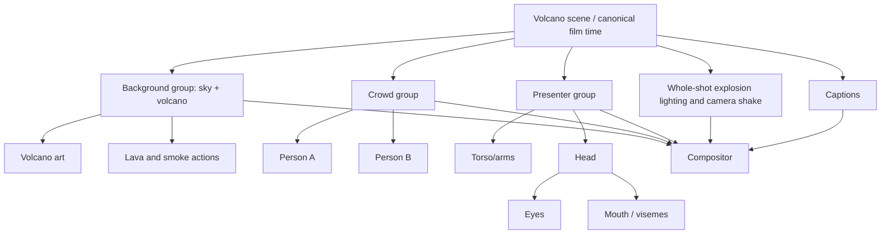

# Layer, Composition & Incremental Revision Research

**Cutroom v2 | Subsystem research | Updated 13 November 2026**  
**Status:** Research and proposed contracts, not approved HLD or LLD; nothing implemented.  
**Parent:** [Main research index](../research-index.md) · [Full vision](../archive/cutroom-v3.1-full-system-architecture.md)  
**Scope:** Scene layers, semantic grouping, effects, compositing surfaces, mixed execution and invalidation.

---

## 13 November addendum — spatial coordination, async surfaces and reversible edits

**DECIDED:** A logical compositing layer is editable production structure, not necessarily a separate process, job or encoded video. The scheduler may co-render tightly coupled layers or split independent jobs by scene, layer, component or frame range. Components use local time and explicit global-time mapping. Jobs may promise partial/progressive frames, seekable surfaces or complete render artifacts; the compositor combines *compatible* outputs, not scene intent.

**DECIDED:** The volcano/background worker publishes **spatial and semantic planning context early**: scene/camera coordinates, expected geometry/bounds, evolving eruption plume/avoid-zone envelope, occlusion/draw-order and shared lighting/effects, event anchors. The character and caption producers consume a pinned layout revision so their animation does not unexpectedly overlap the volcano. If the eruption's accepted size/plume/camera changes, dependent staging and render caches are revalidated or invalidated; no automatic blind overlay. Use simple spatial annotations when adequate; richer geometry only for justified interactions.

**DECIDED:** All objects, visual layers, code components and derived render surfaces belong to a **versioned, rollback-capable project**. Edits to one object/layer should preserve unrelated accepted work when dependency analysis permits. The accepted executable render plan uses frozen revisions; experimental branches must not overwrite approved surfaces. Reuse and rendering speed require real benchmarks, not a promise of automatic parallel speedups.

**Contract shape and deeper study:** [Production futures and spatial contracts](07-production-coordination-futures-and-spatial-contracts.md) · [Versioning and lineage](08-versioning-lineage-and-experiment-memory.md) · [HLD baseline](../HLD-ENTRY.md). Earlier layer/caching/compositing research remains applicable.

---

## Updated architectural implications — method selection and independent layers

**DECIDED REQUIREMENT (12 Nov 2026):** The harness and execution planner may vary animation and rendering *methods independently of the scene's logical object and visual-layer identity*. For a volcano shot, an eruption can use vectors/sprites/particles/real media, while foreground performers can use IK puppets or pose atlases. Combining methods is allowed where the selected plan can satisfy shared film-time, coordinate, alpha, z-order and interaction/effect contracts. Renderer boundaries are not the same as visual layer boundaries.

**RESEARCH CANDIDATE:** Track semantic/event dependencies (`eruption.start` causes `alice.reacts`), resource/action dependencies (`handoff` requires reachable grip anchors or adapted pose sprites), and render-surface dependencies (eruption glow tints the actor layer). Cache invalidation must follow all three rather than only visual layer IDs.

**OPEN:** Whether the first eventual implementation uses one browser composition, offscreen RGBA subpasses, or independently rendered tracks. Cross-renderer lighting, occlusion and filter effects require explicit compatibility, not optimistic blending assumptions.

---

# Part IV — Intensive research track 2: Layer architecture, compositing and incremental editing

## 7. A layer is not necessarily a flattened video

There are at least **three different concepts**:

- **Semantic group:** named parts belonging together, such as `presenter`, `volcano`, or `crowd`. Contains narrative relationships and editable objects.
- **Visual layer / compositing node:** participates in ordering/masks/filters and may contain many objects or nested groups. A character's head/mouth may be sublayers, while the full character is a parent.
- **Rendered surface or cache:** bitmap, texture, transparent video, or set of frame buffers produced by a backend; an optimization artifact, not the editable master.

Conflating them would make editability illusory. Rendering `presenter` into one image per frame is sometimes fine for caching; it must not erase our ability to edit its mouth without reconstructing the source state.

### 7.1 Volcano shot layer graph (illustrative)



In one version the volcano art and erupting smoke might be the same render pass, in another they might be separate. The **logical object hierarchy** remains separate from the selected **render-pass partition**.

## 8. Composition rules and media contracts

Minimum render surface descriptor (research proposal):

```yaml
surface:
  width: 1080
  height: 1920
  pixel_format: rgba8 # or a specified higher-precision format
  alpha: premultiplied
  transfer: srgb # specify whether stored values are display or linear
  color_primaries: bt709
  timebase: {num: 1, den: 30}
  output_frame: 155
  scene_revision: rev_42
  coordinate_space: output_pixels
  z_order: 20
  cache_hash: sha256:...
  contains: [character:presenter, event:double_take]
```

The precise spec remains open. Alpha mode and color operations cannot be hand-waved away. For conventional source-over compositing, if `C_s` and `C_b` are **non-premultiplied** colors and `α_s`,`α_b` opacities, the premultiplied output is:

`c_out = C_s α_s + C_b α_b (1−α_s)`; `α_out = α_s + α_b (1−α_s)`.

If inputs are already premultiplied (`c_s=C_s α_s`, `c_b=C_b α_b`), use `c_out = c_s + c_b (1−α_s)`. Blending in an unsuitable color space can produce visible differences; formulate one end-to-end color policy and verify the rendered output. See [W3C Compositing & Blending Level 1](https://www.w3.org/TR/compositing-1/).

### 8.1 Shared time, distinct source time

Each layer may use a different local time mapping:

- Global `film_time` is authoritative, likely rational.
- Shot time is relative to the shot start.
- A video layer maps shot time to source PTS (trim, playback rate, reverse, freeze).
- A sprite animation maps its own local start to keyframes or state-machine time.
- Music can use tempo/beat positions; audio mixing uses sample time.

A backend adapter must accept `render_subplan(global_t, frozen_inputs)` and either compute the correct state or return a structured incapability. The **harness** doesn't manually calculate thousands of local times.

## 9. Reuse through dependencies—not just z-index

Your idea of rendering the volcano once and testing many presenters is highly plausible. Define a dependency DAG over stable semantic objects, resolved animation tracks, assets, shader settings, render subpasses, and resulting artifacts.

Example:

```text
volcano art ─┐
             ├─> background pass cache ────────────┐
eruption anim┘                                     ├─> final composite ─> output
presenter rig ─> foreground pass A/B/C cache ────┤
captions ────> caption pass cache ─────────────────┘
```

A patch `presenter.expression = anxious` should invalidate the presenter pass and composite (plus any dependent light/occlusion/perceptual review), but not the immutable volcano art. A patch to the explosion time may invalidate the explosion render, its audio, the crowd/presenter dependent reactions, global light, and composite. A changed font may invalidate typography/captions and any layout dependent on text size.

### 9.1 Three different kinds of locality

1. **Semantic locality:** The patch changes a named presenter action, not the volcano story beat.
2. **Dependency locality:** Which other objects actually read that state, directly or transitively?
3. **Frame/time locality:** Which intervals need rerendering, including transition overlap, audio reverb, motion blur and effects tails?

Do not equate these. An edit to one semantic event can have globally visible consequences. A conservative rebuild of the whole shot is correct even if inefficient; a mistakenly reused corrupted shot is unacceptable.

### 9.2 Cache levels to investigate

- Original sourced media, conventionally rendered image/video artifacts and waveforms: content-addressed immutable assets.
- Preprocessed assets: resized images, masks, sprite atlases, audio alignments (versioned by tools and settings).
- Compiled per-object animation curves and schedule: cache by relevant IR subgraph hash.
- Static draw list or render texture: cache when time invariant and free of cross-pass effects.
- Frame-range subpass cache: reuse background animation in multiple character candidate branches.
- Final composite and encoded segments: reuse when delivery spec, boundaries, audio and inter-pass dependencies match.

**Risks:** video codec interframe dependencies may require re-encoding around segment boundaries; cross-layer shadows and shared camera moves invalidate naive subpass caching; storing all raw RGBA frames would be enormous (1080×1920×4 bytes ≈ 8.3 MB per full-resolution frame, ~22.4 GB for 90s at 30fps before compression/overhead). Cache must be selective and budgeted.

### 9.3 Research on offscreen rendering

PixiJS v8 documents rendering to offscreen textures/targets; render layers separate logical ancestry from drawing order. FFmpeg supports compositing independent streams with its `overlay` filter and other complex filtergraphs. These establish **usable primitives**, not that independently generated DOM/scene-graph outputs automatically align visually. Study GPU texture sharing, PNG/RGBA capture costs, alpha video intermediates, chroma sampling, masks, font rasterization and timestamp alignment. Reuse without independent frame capture may be superior to writing intermediates to disk.

Primary refs: [PixiJS render layers](https://pixijs.com/8.x/guides/concepts/render-layers), [PixiJS render targets](https://pixijs.download/v8.22.0/docs/rendering.html), [FFmpeg overlay/filters](https://ffmpeg.org/ffmpeg-filters.html), [W3C compositing](https://www.w3.org/TR/compositing-1/).

## 10. What 2D scope means for future 2.5D/3D

We deliberately **do not** implement parallax depth fields, 3D mesh rigs, perspective cameras or multiple full-dimensional compilers now. We can nonetheless define **non-prescriptive extension seams**:

- a scene actor has a representation capability manifest;
- visual subplans output a declared surface (RGBA, optional masks, timing and transforms);
- coordinate/time conversions are explicit;
- 2D entity identity is independent of output pixels;
- future depth/normal/motion passes can be added **without** forcing them into the initial Render IR.

Avoid speculative abstractions that make the 2D engine harder to implement. Revisit after real constraints emerge.

### Track 2 research questions

- Can an HTML/SVG pass and PixiJS pass share the same frame host while retaining meaningful independent masks?
- How should nested groups handle clipping, transform inheritance, opacity, blend isolation and compositing order?
- Are camera motion and global grading precomposite or postcomposite effects, and what is their dependency footprint?
- When is alpha output fidelity worse than a joint render? Which category of shots should reject splitting?
- What is the memory limit for cached render textures? Which progressive frame ranges offer the best tradeoff?
- Can reviewers inspect a **single layer without its context** and also inspect full context (both needed)?
- Can all scene representations survive a round trip through visual editor semantic edits?

**Gate:** Documented layer graph semantics, common surface/color/time contract, occlusion/interactions model, conservative invalidation rules, cache levels, and test vectors (no tests run yet).

---
