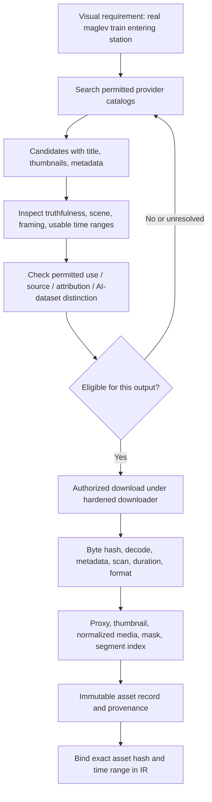

# Real-Media Asset Retrieval, Rights & Preparation Research

**Cutroom v2 | Subsystem research | Updated 13 November 2026**  
**Status:** Research and proposed contracts, not approved HLD or LLD; nothing implemented.  
**Parent:** [Main research index](../research-index.md) · [Full vision](../archive/cutroom-v3.1-full-system-architecture.md)  
**Scope:** Finding, verifying, acquiring, storing, normalizing and citing real images/video/audio for 2D production.

---

## 13 November scope boundary — no image/video-generation models

**DECIDED:** Cutroom v2 may import rights-eligible **genuine existing** photographs, footage, music and other media, and may create drawings/sprites/graphic elements by **LLM-authored SVG/Canvas/HTML/CSS/programmatic 2D code** rasterized conventionally. It **does not** use image-generation or video-generation models to synthesize pixels or generate character frames. Keep source provenance, rights and content identity separate from versioned code-made visuals and derived sprites. User-provided prepared art is optional; a brief is sufficient to initiate programmatic graphic design.

**Integration:** Media discovery/source checks and programmatic asset creation can publish versioned metadata and provisional layouts to other scene producers before final heavy assets are ready; final compilation pins accepted bytes, rights and timing. [Coordination](07-production-coordination-futures-and-spatial-contracts.md) · [Versioning](08-versioning-lineage-and-experiment-memory.md) · [HLD entry](../HLD-ENTRY.md).

---

# Part VI — Intensive research track 4: Real image and video retrieval, downloading and preparation

## 13. Retrieval and acquisition are separate from the compiler

The compiler consumes **resolved, stable assets**. It should not search the internet every time it renders frame 143. Real-media discovery belongs to the upstream **Asset Acquisition subsystem**, controlled by the same harness through tools and recorded in the project.



### 13.1 Search objects must contain more than keywords

A `MediaNeed` might specify:

```yaml
need_id: media:maglev_arrival
content_class: authentic_real_video
subject: operating_maglev_train
visible_action: approaches_platform
preferred_camera: side_view
minimum_usable_s: 3
aspect_fit: vertical_crop_safe
factual_role: evidence_of_real_transport
needs_clean_space_for_overlay: true
avoid: [unrelated_wheeled_train, synthetic_reenactment, misleading_brand]
rights_required: commercial_edit_distribution
```

The system needs *visual-moment matching*: find the **3–6 second usable interval**, not merely a 90-minute video about trains. Search can return a list of candidates; thumbnail embeddings, shot-boundary detection, video sampling, audio transcripts and human review are possible ranking stages. None alone proves authenticity or licensing. The asset manifest must record which actual file and source interval were selected.

## 14. Provider-by-provider research

| Source | API/discovery facts | Operational and rights cautions | Candidate use |
|---|---|---|---|
| **Wikimedia Commons / MediaWiki API** | `imageinfo` can return original URL, MIME, sizes, metadata and `extmetadata` with creator, license and attribution fields; structured data is still partial | Metadata may be incomplete, HTML-encoded or unreliable for multi-license assets; per-file rights and subject permissions need verification | Historical pictures, documents, scientific images, occasional media clips |
| **Pexels API** | Official REST API provides search for photos and videos, with source file variants and filters | October 2026 terms restrict standalone redistribution, mass catalog replication and unauthorized AI training/evaluation dataset collection | Stock B-roll, atmosphere and transitions where permitted |
| **Internet Archive** | Item metadata endpoint `/metadata/{identifier}` returns item fields and files; archive identifiers and file records | An item being downloadable does not guarantee reuse rights; validate item/file-specific rights, format and authenticity | Historical footage, archival recordings and public-domain candidates |
| **Unsplash API** | Official API has hotlinking, attribution and download-event (`download_location`) integration requirements | API behavior and retention rules may conflict with a native immutable media archive; need provider-specific permitted use/retention interpretation before adoption | Photos via compliant API integration if project model fits terms |
| **User-provided media** | Files or provider-backed uploads, often best source of unique content | Consent, title, license and integrity are not automatic even for uploads | Creator-provided clips, own recordings, licensed brand assets |
| **Commercial licensed catalog** | Partner API or contract-specific rights and download endpoints | Cost, permitted territory, attribution, digital rights and reuse requirements vary | Reliable commercial distribution if agreement is suitable |
| **Open web / platform video pages** | Search may find references and metadata | A publicly playable video is **not** automatically downloadable or reusable. YouTube terms prohibit unapproved reproduction/download except as authorized | Discovery/link evidence; do not treat as automatic raw-media supply |

Primary refs: [MediaWiki Imageinfo](https://www.mediawiki.org/wiki/API:Imageinfo/en), [Commons machine-readable data](https://commons.wikimedia.org/wiki/Commons:Machine-readable_data), [CommonsMetadata extension](https://www.mediawiki.org/wiki/Extension:CommonsMetadata/en), [Pexels API](https://www.pexels.com/api/documentation/), [Pexels October 2026 terms explanation](https://help.pexels.com/hc/en-us/articles/900005880463-What-are-the-Terms-and-Conditions), [Internet Archive item metadata](https://doc-tools.readthedocs.io/en/ia-test-gsod/md-read.html), [Internet Archive metadata fields](https://internetarchive.readthedocs.io/en/stable/metadata.html), [Unsplash July 2026 API guidelines](https://help.unsplash.com/en/articles/2511245-unsplash-api-guidelines), [Unsplash API terms](https://unsplash.com/api-terms), [Unsplash download events](https://help.unsplash.com/en/articles/2511258-guideline-triggering-a-download), [YouTube Terms](https://www.youtube.com/t/terms).

### 14.1 A rights registry must not conflate different permissions

At minimum distinguish:

- view/preview access;
- downloading / local preservation;
- editing and transformative reuse;
- distribution in output video and commercial use;
- attribution, ShareAlike or other license conditions;
- human likeness, publicity rights, trademarks and restricted subject matter;
- consent to use media in **AI training, fine-tuning or evaluation datasets** (a separate rights question);
- geographic, temporal, organization and contract scope.

Automated metadata is *evidence to inspect*, not a legal verdict. A useful state machine is `candidate → rights_unreviewed → evidence_collected → eligible_for_profile / restricted / unresolved`. An unresolved record must not be silently promoted to publishable.

### 14.2 Downloading the selected bytes

A **provider adapter** receives an approved provider asset ID and returns a source-specific, authorized acquisition plan. A **hardened download worker** then performs the network operation (no unrestricted arbitrary shell command required), with the following responsibilities:

1. Credentials and provider endpoints through a trusted broker; no tokens inside a generated video script.
2. Host and IP destination validation, redirects checked or disabled under provider policy, TLS, egress restrictions. **SSRF matters** whenever the system fetches user-influenced URLs.
3. HTTP streaming or range requests where permitted; content-length caps, timeouts, retries with backoff, budget and network limits.
4. File signature/codec probing, MIME and declared-vs-actual type checks; reject archives or decompression bombs and suspicious encodings.
5. Store exact original bytes (if permitted), checksum and source response metadata, licensing evidence and acquisition timestamp.
6. Generate derived proxies or transcoded normalized assets; never overwrite source original; identify converter version/settings.
7. Handle license/attribution and deletion policies separately from cache eviction.

Security ref: [OWASP SSRF Prevention Cheat Sheet](https://cheatsheetseries.owasp.org/cheatsheets/Server_Side_Request_Forgery_Prevention_Cheat_Sheet.html). Media probing: [FFprobe documentation](https://ffmpeg.org/ffprobe.html).

### 14.3 Preparing real media for 2D composition

**Image:** correct orientation, color profile, alpha/foreground masks as applicable; create proxies and intelligent crop candidates; verify factual attribution, not just object similarity. A user should be able to replace the image independently while retaining the authored zoom/pan if requested.

**Video:** inspect codec, frame rate, variable presentation timestamps, duration, dimensions and audio streams; select source in/out; decode corresponding source frames for film time; prepare preview proxies where useful; resolve aspect fit and crop; estimate text-overlay safety; track stabilization/crop and color normalization as derived operations. The original remains independently addressable.

**Real-media overlay:** a painting photo can be a background image; a separate sprite/doodle layer animates above it. A real train clip can occupy a background video plane while force vectors, labels and a presenter remain vector/puppet layers. This is still an entirely **2D Cutroom pipeline**.

### 14.4 Example: authentic Picasso image vs illustration

The `MediaNeed` should explicitly distinguish **show an authentic work** from **show a stylized artwork inspired by a style**. A generated substitute is not an equivalent depiction when the story asserts it shows the actual work. The asset service should record title, painter, specific reproduction, source, rights and factual review. Artwork rights and reproduction/photo rights can differ. The director can select another visual strategy (description, licensed crop, an annotated diagram) if a suitable real file is ineligible.

### 14.5 Example: maglev scene retrieval

Search provider catalogs; inspect frames for a train demonstrably relevant to the claimed mechanism; find a usable time interval; score camera angle, crop, text safe area and authenticity; verify permission; acquire exact source, decode into source-time-indexed frames; bind IR references. Then a Cutroom overlay animation can explain levitation without misleadingly drawing wheels/rails for a different system.

### Track 4 questions

- Which provider agreements actually permit automatic ingestion into a persistent, user-editable production archive?
- Can we design one reliable `MediaNeed → candidates → eligible asset` tool contract without falsely normalizing rights?
- How do we rank **the useful interval** in long videos, not just the page's title or thumbnail?
- How costly is visual/video indexing and does creator review remain necessary for authenticity?
- How do we gracefully handle 'no legal usable source' rather than resort to unlicensed scraping?
- Does acquisition stay local desktop-first or run in an isolated remote service? How do we protect network and credentials?
- How do we preserve sources even after a provider URL changes or an asset is taken down, within permitted retention terms?

**Gate:** provider integration and rights matrix, retrieval/interval model, hardened downloader specification, source/derived manifest, clearance-policy rules, human decision UX. No general web downloader should be launched without these safeguards.

---
