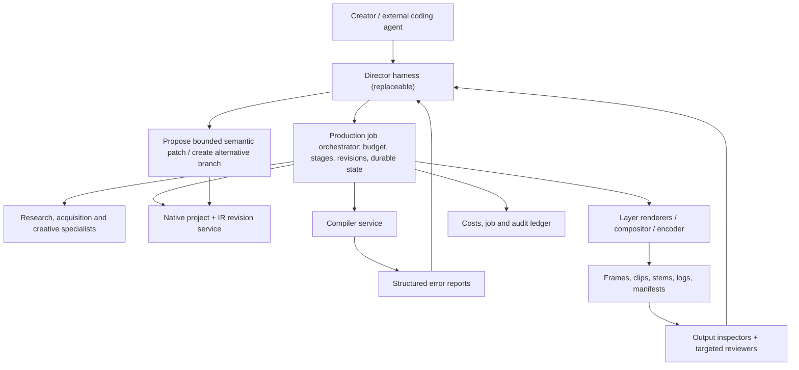

# Agentic Harness, Experiment Agent & Production Recovery Research

**Cutroom v2 | Subsystem research | Updated 13 November 2026**  
**Status:** Research and proposed contracts, not approved HLD or LLD; nothing implemented.  
**Parent:** [Main research index](../research-index.md) · [Full vision](../archive/cutroom-v3.1-full-system-architecture.md)  
**Scope:** Director orchestration, domain tools, durable jobs, experimental comparison, capability production and evidence-driven repair.

---

## 13 November HLD inputs — coordination, version history, and bounded experiments

**DECIDED:** The main harness takes a **brief** and owns end-to-end creative production. In v2 it may ask LLMs to produce **renderable code** for illustrations, sprites, graphics and animation, but **no image/video-generation models** are used. Source genuine media when permitted. Choose the simplest compelling acting/visual method for the scene; richer structured graphs, IK, puppets or dedicated render passes remain available when helpful.

**DECIDED:** A **versioned producer/consumer contract** supports async work throughout research, script, scene layout, character/style design, media acquisition, narration/audio, action resolution, frame rendering, compositing, review and experimental variants. Begin consumers from sufficiently stable scene/event/style/spatial commitments, not by waiting for every final MP4. Treat stale/superseded promise results as invalid, use bounded concurrency and cancellation, and allow workers to publish partial progress without disguising it as final acceptance. No requirement that each logical subsystem be a separate service or agent.

**DECIDED:** Every accepted production state and trial has traceable revisions, candidate branches, generated code/asset lineage, scoped patches, locks, rollback, dependency-driven cache reuse and evaluation evidence. Harness/Experiment Agent must consult earlier relevant successes and failures before repeating trials; rerun only with a meaningful changed hypothesis or justified transient-failure retry. Failures are contextual evidence, not universal prohibitions.

**DECIDED:** A dedicated **callable** Experiment Agent compares uncertain techniques anywhere in the system on isolated revisions and returns evidence; main harness approves promotions. An Experiment Agent must measure time-to-preview, total accepted-result time, revision latency and resource/cost impact when comparing performance plans, not only pixel quality or fps.

**Technical/Phase C details still OPEN:** scheduler/runtime/process topology, authoritative Project Core interface, evidence retrieval/memory implementation, artifact future schema, loop/timeout/retry policies and exact hard-constraint/quality thresholds. Main Director authority and diagnostic-first acceptance behavior are already settled in Phases A/B. Read [HLD entry](../HLD-ENTRY.md), [coordination/futures](07-production-coordination-futures-and-spatial-contracts.md) and [versioning](08-versioning-lineage-and-experiment-memory.md). Earlier in-depth harness/experiment research remains useful; these constraints supersede contradictory older candidates.

---

## 13 November Phase B2 acceptance — modular harness coordination and evidence-rich outcomes

**ACCEPTED:** One Director/Harness supervises all systems, with a minimal plugin-oriented capability surface and **scoped, useful delegation**. The "shared production blackboard" is a view over Project Core's accepted/candidate revisions, commitments, source evidence and Scheduler state; **not** a second authoritative memory service. Workers receive scoped goals, read and write sets, frozen/provisional dependencies, resource budgets and permissions. They publish versioned results and meaningful events; the Director is notified of decisions, conflicts and material failures, rather than relaying every result via an LLM message. When agent-to-agent coordination changes a relevant shared assumption, record a revised commitment. Routine tool concurrency and artifact dependency order are independent of conversational turn order. See [HLD B2](../hld/02-phase-b-production-lifecycle-and-autonomous-quality.md#b2--subsystem-handoffs-collaboration-and-asynchronous-execution).

**ACCEPTED:** Workers should return a concise error summary **plus references to a retrievable diagnostic evidence bundle** (expected versus observed output; precise scene/frame/time/code; actual previews and logs; confidence-tagged causes; tested fixes; affected dependencies and targeted remedies). A worker may do bounded local repair within its assigned write scope; changes to story/meaning, global dependencies or repeated failed attempts return to the Director. Avoid a mandatory Debugging Agent. Reviewer is callable/read-only with shared authoritative ground truth and fresh critical context; Experiment Agent tests isolated alternatives and reports evidence; neither is an alternate Director. See [Quality research](09-quality-evaluation-review-and-recovery.md).

### Current external harness precedents — research, not technology adoption

| Source | Observed mechanism | Cutroom design consequence |
|---|---|---|
| [DeepSeek Harness architecture](https://github.com/deepseek-ai/deepseek-harness/blob/master/docs/architecture.md) | Cordis plugins supply replaceable services, typed events and reversible registrations | Keep capabilities replaceable and event-aware without a privileged fixed loop |
| [Pi extensions](https://pi.dev/docs/latest/extensions) | Hooks around agent turns, tools and execution; custom tools/extensions with process-level permissions | Small adaptable core, observable tool lifecycle; isolate untrusted production code |
| [Claude Code subagents](https://code.claude.com/docs/en/sub-agents) | Separate scoped context, restricted tools and summarized return | Use specialists for context isolation and targeted useful work |
| [Claude Code agent teams](https://code.claude.com/docs/en/agent-teams) | Shared tasks, dependencies, team messages, coordination overhead and token costs | Useful task ownership and negotiation; avoid automatic agent teams for every small operation |
| [Codex multiagent delegation guidance](https://github.com/openai/codex/blob/main/codex-rs/core/src/tools/handlers/multi_agents_spec.rs) | Narrow sidecar work, non-overlapping write sets, limited waits, no redundant delegation | Keep critical path moving, dedupe work and avoid write conflicts |

**Evidence boundary:** These documents support the mechanisms described; they do **not prove** Cutroom's future scheduling speedup or review effectiveness. We are not committing to directly embedding DSH, Pi, Claude Code or Codex. No independent Cutroom v2 runtime benchmarks are claimed.

## Current research direction — dedicated Experiment Agent and on-demand capability remediation (12 November 2026)

**DECIDED DESIGN INTENT:** The main Cutroom harness/director remains responsible for the overall production goal, authorization, accepted revisions, budget boundaries and final decisions. It should be able to invoke a **dedicated Experiment Agent** to independently plan and run bounded comparative experiments **across the whole Cutroom system**, rather than hand-designing and running every trial itself. This is a role and tool contract; we have **not selected a model, agent framework, process topology, or workflow backend**.

**DECIDED DESIGN INTENT:** The Experiment Agent is not restricted to rendering. Its scope may include character rigs/IK vs sprite sequences, DSL/lowering strategies, visual looks, renderer assignments, compositing, frame-seek behavior, caching, asset retrieval, evaluator calibration, reviewer routing, and production policy. The harness must be free to experiment directly where justified and may choose not to delegate trivial decisions.

**RESEARCH CANDIDATE:** The Experiment Agent should have a durable scoped **ExperimentSpec -> CandidateTrials -> EvidenceBundle -> Recommendation** contract, but no authority to overwrite an accepted project, approve rights exceptions, or change compiler policies on its own.

### Separation of responsibilities

| Role | Accountable for | Not automatically authorized to do |
|---|---|---|
| Main creative director / harness | Define production goals, open questions and decisions; delegate experiments; accept candidate edits per policy | Invent unrecorded renderer state; bypass hard constraints |
| Execution planner | Filter technically feasible methods; report compatible target choices, costs and dependencies | Choose artistic goals or change semantics without direction |
| Experiment Agent | Design controlled comparisons, execute trials through allowed tools, diagnose, record quality/cost/failures, recommend methods | Declare unmeasured superiority; publish new unreviewed capabilities into all projects |
| Capability / Asset Producer | Prepare missing rigs, anchor metadata, pose atlases, new animation implementations or transformations | Silently overwrite a locked character model or accepted artifact |
| Registry / Project Service | Store versioned recipes, validation state, evidence, dependencies, permissions and conflict-aware promotion | Infer subjective acceptance merely because a schema validates |
| Reviewers | Assess rendered evidence for acting, readability, style and correctness; note uncertainty | Overwrite project or decide on unobserved video frames |

### ExperimentSpec — proposed message shape

```yaml
experiment:
  id: exp-handoff-017
  requested_by: production-director
  project_revision: rev-43
  scope: [scene:handoff, behavior:handoff_document]
  question: Which method best achieves a readable, editable 2D handoff?
  candidates:
    - puppet_ik_2d
    - authored_sprite_sequence
    - hybrid_hand_prop
  constants: [script, character_identity, output_fps, background, shot_duration]
  metrics: [contact_continuity, expressive_quality, controllability, cost, rerender_time]
  required_evidence: [isolated_actor_preview, full_composite, contact_frame_samples, manifest]
  budget: {max_trials: 3, max_cost_usd: 4.0}  # illustrative, not policy
  allowed_mutations: [candidate_branch_only]
  stop_when: [clear_winner, diminishing_returns, budget_exhausted]
  promotion_authority: main_director  # Autonomous by default; policy/brief constraints still enforced
```

**Proposed trial flow:** receive the spec; clarify feasibility internally; produce/test comparable candidate revisions under the same constraints; collect isolated and full-context frame evidence; distinguish failures (`invalid plan`, `capability gap`, `runtime fault`, `visually poor`); return metrics, uncertainty and manifest; have the main harness decide what to try next or propose for acceptance.

**The Experiment Agent does not need to be an always-on second monolith.** It can be a callable specialist behind the existing replaceable harness adapter, with durable jobs managed by the production job service. An LLM can direct experiments; deterministic test runners, renderers and evaluators can execute specific operations. Exactly one workflow owner must retry each external effect; branch and job IDs prevent cross-trial state corruption.

### Reusable experience/technique registry

A proposed registry is **dynamic and evidence-backed**, storing mappings such as `requested operation + character/asset context + visual style + rendering constraints -> candidate methods + observed outcomes`. Each entry should include source/revision, applicability scope, test footage, costs, known failures and expiry/retest policy. The planner should consult it as prior evidence, **not** a fixed expert system that forbids novel approaches. New recipes may be proposed by the Capability Producer and assessed by the Experiment Agent before scoped promotion.

### Handling missing capabilities during a live production job

```text
Compile request -> CapabilityGap diagnostic
  -> harness evaluates plausibility, authority, cost and available remedies
  -> optionally delegate to Experiment Agent / Capability Producer
  -> generate/adapt rig controls, sprite poses, procedural clip, or representation
  -> validate contact/channel/schedule/media constraints
  -> preview in isolation AND composite; critique and compare
  -> create candidate asset/recipe revisions with provenance and tests
  -> select/approve and recompile accepted candidate branch
  -> freeze executable plan and render reproducibly
```

This is **production-time dynamic extensibility**. It does **not** imply the renderer invents animation code while rasterizing individual frames, or that an agent edits trusted production compiler code to get around a failure.

### Unresolved HLD questions

1. Where is the Experiment Agent's lifecycle owned—director harness versus production workflow—and how are budgets/cancellations handled?
2. What makes trials fair across renderers (asset quality, frame samples, resolution, budgets, animator preparation time)?
3. What is a publishable capability/technique recipe and what approval is required to reuse it across projects?
4. How do we combine subjective critique with technical invariants, repeated trials and confidence estimates?
5. When should the director bypass Experiment Agent for a simple known choice, and when do we schedule a full comparison?
6. How do we prevent evaluator overfitting and unlimited self-modifying experiments?

---

# Part VII — Intensive research track 5: Agentic harness controlling the whole production

## 15. Agent-controlled production environment, not a model-only video generator

The creator describes what they want, but Cutroom needs an **autonomous, tool-using director** that can inspect the current production, delegate bounded tasks, make revisions, execute compilers/renderers, interpret failures, see output, and decide next actions. It can be controlled by a person or another agent (Codex, Claude Code, an external workflow) through public APIs/CLI/MCP without requiring that external agent to know the renderer's internal file layout.

This is **not** `LLM(prompt) → JSON → render → success`. Instead it is a durable, observable process:



**Trust boundaries:** The harness can *request* operations and select permissible candidates. The project service validates every mutation; the compiler enforces type/temporal/capability invariants; isolated workers execute generated scripts/media operations; the workflow service owns external-job retries; the creator owns acceptance/publishing per chosen policy. A confident model narrative cannot override a failed constraint check or missing usage rights.

### 15.1 Agent harness vs job orchestrator vs domain services

- **Agent harness:** model turns, tool routing, context construction, conversation/specialist branches, steering, UI and model-specific continuity.
- **Durable workflow / job controller:** persistent task state, retry ownership, scheduling of render/acquisition/provider activities, cancellation scopes, idempotency, budgets and recovery.
- **Project/IR service:** stable revisions, branches, locks, patch validation and project truth.
- **Compiler:** finite, specified transformation from frozen resolved input to executable 2D plan or useful diagnostics.
- **Renderer:** pure or controlled frame/time evaluation and rasterization; no creative reinterpretation.
- **Reviewers:** examine output artifacts with rubric, evidence, uncertainty and actionable proposed repairs; not direct mutation authority.

Logical responsibilities may share a desktop process initially; they should retain clean API contracts regardless. One tool may dispatch to another service, but no LLM should be needed to approve every normal per-frame operation.

## 16. Existing harness and workflow technology (research, not selection)

| Candidate | Verified available capability | Cutroom relevance / boundary |
|---|---|---|
| **Pi SDK** | Embed a TypeScript/Node or Bun agent runtime, sessions, custom tools, streaming events, persistent conversation trees | Candidate director harness; Cutroom owns IR, mutation rules and expensive jobs; Pi extensions run with process permissions, so isolate untrusted code |
| **Pi Durable** | Experimental durable agent conversations/tasks/recovery | Possible agent-task persistence; **not proof** that media/provider activities can be retried safely without separate idempotency |
| **LangGraph** | Checkpointed workflows, interrupts and resumption | Candidate for explicit orchestration/reviewer graph; resumed node bodies can re-execute, so external calls must be controlled |
| **Temporal** | Durable workflow/event histories, workers and activity tasks | Candidate production-job service; operational complexity must be justified for desktop-first ambitions |
| **MCP** | Discoverable model-controlled tools with schemas, explicit security/authorization considerations | Useful external-agent interface, not a renderer nor project-state authority |
| **Plain CLI / HTTP API** | Structured inputs, outputs, job handles and event streams | Essential even if MCP is offered; straightforward testing and integration |

Primary refs: [Pi SDK](https://pi.dev/docs/latest/sdk), [Pi extensions](https://pi.dev/docs/latest/extensions), [Pi Durable](https://github.com/earendil-works/pi/blob/main/packages/durable/README.md), [LangGraph interrupts](https://github.com/langchain-ai/docs/blob/main/src/oss/langgraph/interrupts.mdx), [Temporal workflow](https://docs.temporal.io/workflows), [Temporal tasks](https://docs.temporal.io/tasks), [MCP tools specification July 2026](https://github.com/modelcontextprotocol/modelcontextprotocol/blob/main/docs/specification/2026-07-28/server/tools.mdx).

**No 'all-in-one harness' assumption:** If Pi manages a conversation and another service retries a media job, only **one** must own external paid provider submission. Otherwise a restart can duplicate billed TTS or other external media-processing requests. If a network response is lost after a provider accepted a request, record an **unknown outcome**, reconcile the provider job ID/request key, and follow a documented retry/cost policy. Repeating an LLM tool call is not the same as safely repeating an external effect.

### 16.1 A proposed typed tool vocabulary

**Read and understand:**

```text
project.get_revision(revision_id)
project.inspect_scene(scene_id, revision_id)
project.list_assets(filter)
compiler.explain_source_map(output_node_id)
render.inspect_frame(frame_index, layer_id?)
review.compare_candidates(candidate_ids, time_range)
```

**Plan and edit:**

```text
ir.propose_patch(base_revision, semantic_operations)
ir.validate_patch(patch_id)
ir.commit_patch(patch_id, authorization_scope)
candidate.branch(base_revision, purpose)
candidate.merge(source_revisions, selected_operations)
primitive.describe_capability(actor_id, operation)
```

**Execute:**

```text
asset.search(media_need)
asset.acquire(candidate_id, approved_profile)
compiler.compile(revision_id, target_profile)
render.request_frames(compilation_id, indices_or_range, layer_selection?)
render.request_preview(compilation_id, range, fidelity)
render.request_delivery(compilation_id, profile)
job.get_status(job_id)
job.cancel(job_id, scope)
job.retry(job_id, reason_and_policy)
```

**Observe:**

```text
compiler.get_diagnostics(compilation_id)
render.get_manifest(render_id)
review.request(revision_id, artifact_ids, rubric, context)
review.get_evidence(review_id)
cost.get_budget(job_scope)
```

These are illustrative operations, not already implemented service endpoints. All mutation calls should include immutable revision preconditions and idempotency keys where relevant; no unbounded shell access should be necessary for basic authoring. A language-learning agent can build a new adapter or DSL primitive in a separate developer sandbox, but ordinary content production shouldn't silently rewrite the compiler or its permission rules.

## 17. How the harness handles failures

### 17.1 Failure classes

| Kind | Example | Appropriate reaction |
|---|---|---|
| **Semantic/typing error** | references unknown actor; invalid duration | Reject patch and ask planner/director for a valid change |
| **Capability failure** | sprite lacks needed head view | Select permitted alternate performance, acquire a view, or report limitation |
| **Constraint conflict** | locked voice vs requested eruption offset | Produce conflict witness/options; do not override lock silently |
| **Asset acquisition failure** | 404, insufficient rights, wrong train | Change source/candidate/provider within rights and policy, or request human decision |
| **Transient infrastructure failure** | worker crash or temporary network outage | Retry safely with capped attempts, checkpoint and idempotency |
| **Unknown external outcome** | TTS accepted but acknowledgement lost | Reconcile provider status before resubmission |
| **Media-decode/renderer failure** | corrupt file, unsupported codec, context loss | Inspect artifact/format; reprepare or switch approved execution path |
| **Factual/perceptual problem** | wrong painting, unreadable reaction | Reviewer identifies specific issue; director proposes semantic revision; rerender |
| **Novel creative exploration** | joke feels flat | Branch an alternative, compare; not a deterministic bug retry |
| **Policy issue** | rights unresolved, exceeded budget | Do not silently bypass; return decision request or eligible fallback |

**Three kinds of retry must remain distinct:** retry same deterministic operation after infrastructure failure; revise structured plan after design/capability defect; search a creative alternative after weak quality. Blind repetition of the same call may not fix any of the last two.

### 17.2 Example: character reaction unreadable

```mermaid
sequenceDiagram
  participant Creator
  participant H as Director harness
  participant P as Project service
  participant C as Compiler
  participant R as Renderer
  participant J as Reviewer
  Creator->>H: Make the presenter realize too late
  H->>P: Propose reaction semantic action
  P-->>H: Candidate rev_43
  H->>C: Compile rev_43
  C-->>H: Checked plan_43
  H->>R: Render event window
  R-->>H: Frames + clip + source maps
  H->>J: Assess readability and comic timing
  J-->>H: Eyes are too subtle at output scale; cite frames
  H->>P: Propose localized new performance branch rev_44
  H->>C: Compile rev_44
  H->>R: Render affected window
  R-->>H: Variant preview
  H-->>Creator: Compare rev_43 vs rev_44; explain changes
```

The reviewer is not guaranteed to be correct; feedback should include actual evidence, rubric, confidence and ideally creator validation. The agent is not the source of truth: it operates over **versioned artifacts**.

## 18. Multi-agent specialists and critic routing

A research agent may select sources and claims; a scene director may plan beats; a performance director may create motion options; a media producer may acquire/clear assets; a compositor reviewer may check occlusion and legibility; a humor critic may evaluate timing; a factual reviewer may flag a misleading diagram. These can be different models, prompts, algorithms or human reviewers. They should be **temporary bounded roles**, not a fixed always-on 20-agent conversation.

A specialist request should include: one bounded question, relevant immutable revision IDs, tool/authority scope, budget, context packet, evidence links and an output schema (`Finding[]`, `PatchProposal`, `MediaCandidates`, etc.). Specialists can suggest changes, but **the shared project service** commits accepted revisions and resolves parallel conflicts. Conversation text is *not* the project database.

### 18.1 Agent control of code without unrestricted mutation

An external coding agent might eventually be able to add a production primitive, render adapter or evaluation function. That is a **developer workflow** requiring reviews, tests, versioning and promotion. During ordinary production, the harness may configure existing primitives and generate safe declarative plans, but must not secretly change compiler logic to make an invalid plan pass.

Untrusted network asset descriptions and page text are **evidence**, not instructions. Prevent prompt injection from propagating into tool authority; context builders need clear trust labels and should not forward secrets to reviewers or external code.

### 18.2 Review evidence and acceptance

The harness should have multiple evidence surfaces:

- a single requested frame or zoomed crop;
- a short range of frames or video clip around an event;
- isolated layer preview *and* context composite;
- audio-only and caption-only checks;
- timing/constraint manifests and diagnostic traces;
- fact/rights provenance; change impact report;
- synchronized A/B candidate comparison with consistent volume, resolution and start times.

Technical validators can check duration, missing frames, source hashes, constraint satisfaction and safe area. Perceptual reviewers can critique staging, comedic timing, acting, pacing, legibility and factual depiction, but are fallible. Human decisions remain important when the issue is subjective.

### 18.3 Preserve independent state-versus-output checks (from an earlier document review)

The retired `DOCUMENT-COMPARISON.md` compared the external *Video Generation from First Principles* document in early November. The underlying external document is **not included in this curated active set**, and its reported experiment was **not independently replicated** during that earlier comparison. The useful design warning remains valid as a research hypothesis:

- **Project-state checks:** does the canonical IR and compiled plan actually contain the requested actor, position, event, selected media and locked relations?
- **Rendered-output checks:** do the actual decoded frames/audio exhibit the promised observable state? Can a reviewer genuinely see the event, or is it hidden/occluded or below the observable resolution?
- **Evidence status:** report `PASS`, `FAIL` or `UNKNOWN` with supporting artifact IDs and uncertainty. A visually hidden actor is not automatically evidence of deletion; a correct authored coordinate is not proof that the renderer displayed it correctly.
- **Fault localization:** use controlled diagnostic previews where justified (isolated layers, distinctive temporary colors, overlays with coordinates, pre/post-encode frame comparison) to distinguish bad authoring, compilation, compositing, encoding and observation. Diagnostics should not contaminate the delivered video.
- **Do not 'repair' the source to hide a renderer defect.** If the intended position is x=500 and a faulty output displays x=512, editing the source to x=488 may conceal the observed shift but corrupt the authoritative project. Identify the cause and validate both semantics and pixels after repair.

These ideas strengthen the current **render → inspect → diagnose → semantic patch** loop. They are requirements to investigate and operationalize, not a claim that a general automatic debugger already exists or that expensive visual checks always outperform deterministic ones. In the earlier comparison, the video's original 2D-sprite experiment was expressly too narrow to establish our broader creative, performance and mixed-media goals.

### Track 5 questions

- Does the director harness need direct file/code access, or is a typed tool/MCP interface sufficient for production tasks?
- Which production operations need durable queue ownership, and can one lightweight workflow engine meet the requirements?
- Which agent roles materially improve decisions enough to justify model costs?
- How does the model receive focused context when there are hundreds of production objects and many candidate branches?
- How do we prevent old render results overwriting an accepted new revision?
- What permissions and isolation are required for generated web scripts, downloaded media, custom effects and external agents?
- How will job recovery reconcile paid provider effects and cancellation racing with completion?
- Can reviewers reliably pinpoint error source from output frames and source maps?

**Gate:** harness adapter contract, domain tool schema, trust/authorization model, task ownership, job state machine, retry policy, reviewer evidence contract, source-of-truth rules, and a failure taxonomy. *No requirement* to choose Pi or any other harness before this work.

---
